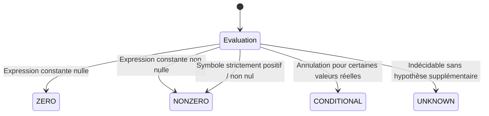
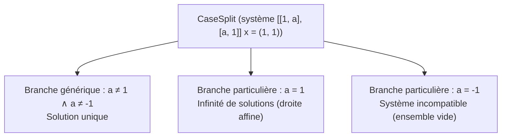

# 01. Noyau formel et Calcul Symbolique Exact

Le module `linalg_pedagopy.core` constitue le socle mathématique fondamental du package. Il garantit la rigueur des calculs formels sur le corps des réels $\mathbb{R}$, empêche les erreurs de troncature numérique et gère de manière déterministe les discussions paramétriques.

---

## 1. Représentation des scalaires et coercition exacte

### 1.1 La fonction `to_exact`

En calcul formel didactique, manipuler des nombres à virgule flottante (`float`) conduit inévitablement à des artefacts déroutants pour l'étudiant (pivots non nuls valant `1e-16`, divisions par zéro masquées, etc.). 

La fonction [`to_exact`](../src/linalg_pedagopy/core/field.py) convertit tout scalaire d'entrée en une expression symbolique exacte SymPy (`sympy.Expr`) selon la politique déclarée :

```python
from linalg_pedagopy import to_exact
import sympy as sp
from fractions import Fraction

# Entiers, fractions et chaînes de caractères
s1 = to_exact(3)           # sympy.Integer(3)
s2 = to_exact("2/3")       # sympy.Rational(2, 3)
s3 = to_exact(Fraction(5, 7)) # sympy.Rational(5, 7)

# Expressions algébriques et radicaux
s4 = to_exact("sqrt(2)")   # sympy.sqrt(2)
s5 = to_exact(sp.pi)       # sympy.pi
```

### 1.2 Politique de gestion des flottants (`float_policy`)

Le comportement face à l'introduction explicite d'un flottant standard (`float`) est régi par [`config.float_policy`](../src/linalg_pedagopy/config.py) :

| Politique | Comportement | Cas d'usage |
| :--- | :--- | :--- |
| `"rationalize"` *(par défaut)* | Convertit automatiquement le flottant en fraction rationnelle approchée (`sp.Rational(str(x))`). | Saisie souple en TD ou console interactive (`0.25` devient `1/4`). |
| `"reject"` | Lève immédiatement une exception [`InexactInputError`](../src/linalg_pedagopy/core/exceptions.py). | Contrôle d'examen ou mode d'exigence formelle stricte. |
| `"keep"` | Conserve le flottant SymPy (`sp.Float`). | Analyse des erreurs de troncature et comparaison avec le numérique. |

Exemple d'utilisation avec `using_config` :

```python
from linalg_pedagopy import to_exact, using_config, InexactInputError

# Par défaut : rationalisation
print(to_exact(0.1))  # 1/10

# Mode strict : rejet
with using_config(float_policy="reject"):
    try:
        to_exact(0.1)
    except InexactInputError as err:
        print(f"Entrée rejetée : {err}")
```

---

## 2. Déclaration et gestion des symboles réels (`symbols`)

### 2.1 Hypothèse `real=True` par défaut (Décision D1)

Dans les systèmes de calcul formel généralistes, un symbole non qualifié $a$ est supposé complexe ($a \in \mathbb{C}$), ce qui empêche de nombreuses simplifications élémentaires (par exemple $\sqrt{a^2} = |a|$ ou la factorisation de carrés).

Dans `linalg_pedagopy`, la fonction [`symbols`](../src/linalg_pedagopy/core/field.py) munit systématiquement les symboles de l'hypothèse `real=True` :

```python
from linalg_pedagopy import symbols

# Déclaration de scalaires réels
a, b, m = symbols("a b m")
print(a.is_real)  # True

# Préservation d'hypothèses supplémentaires
x, y = symbols("x y", positive=True)
print(x.is_positive, x.is_real)  # True True
```

### 2.2 Préservation et correspondance des symboles

Lors des substitutions partielles ou complètes, la fonction [`match_symbol_substitutions`](../src/linalg_pedagopy/core/field.py) fait correspondre les variables par leur nom textuel si nécessaire, évitant ainsi les incompatibilités entre symboles SymPy de mêmes noms mais créés dans des contextes distincts.

---

## 3. L'Oracle de nullité (`ZeroOracle`)

### 3.1 Pourquoi un oracle dédié ? (Décision D3)

En présence de paramètres symboliques, tester si un scalaire $v$ est nul (`v == 0`) ne peut pas être une simple opération booléenne :
- Si $v = a - 1$, la réponse dépend de la valeur de $a$.
- Si l'on répond aveuglément `False`, on risque de diviser par $a - 1$, rendant le pivotage invalide pour $a = 1$.
- Si l'on répond aveuglément `True`, on ignore le cas générique $a \neq 1$.

L'instance globale [`oracle`](../src/linalg_pedagopy/core/zero.py) évalue la nullité selon quatre verdicts :

```python
from linalg_pedagopy.core.zero import Verdict, oracle
from linalg_pedagopy import symbols

a, = symbols("a")

dec1 = oracle.decide(0)
print(dec1.verdict)  # Verdict.ZERO

dec2 = oracle.decide(3)
print(dec2.verdict)  # Verdict.NONZERO

dec3 = oracle.decide(a - 2)
print(dec3.verdict)  # Verdict.CONDITIONAL
print(dec3.factors)  # (a - 2,)

print(oracle.decide(a**2 + 1).verdict)  # Verdict.NONZERO
```

### 3.2 Les 4 Verdicts



1. **`Verdict.ZERO`** : L'expression se simplifie formellement en 0 de manière inconditionnelle.
2. **`Verdict.NONZERO`** : L'expression est inconditionnellement non nulle sur $\mathbb{R}$ (ex: $a^2 + 1$, $e^x$, ou constante non nulle).
3. **`Verdict.CONDITIONAL`** : L'expression peut s'annuler pour des valeurs réelles particulières des paramètres. L'oracle extrait les facteurs d'annulation (`dec.factors`).
4. **`Verdict.UNKNOWN`** : L'expression ne peut être décidée sans hypothèse explicite. L'appel à `oracle.is_zero(expr)` (qui renvoie `True`/`False` quand la réponse est inconditionnelle) lève alors une [`UndecidableZeroError`](../src/linalg_pedagopy/core/exceptions.py).

### 3.3 Traitement des radicaux paramétriques (`unrad`)

Les expressions contenant des racines carrées paramétriques (comme $\sqrt{1 - m^2}$ ou $\sqrt{a^2 + b^2}$) sont traitées via [`_extract_factors`](../src/linalg_pedagopy/core/zero.py) :
1. L'oracle fait appel à `sympy.solvers.solvers.unrad` pour éliminer les radicaux de l'équation $f(m) = 0$.
2. Il résout la partie polynomiale sur $\mathbb{R}$.
3. **Filtrage des racines parasites** : Chaque racine candidate $r$ est réinjectée dans l'expression radicale initiale pour vérifier que $f(r) = 0$. Cela élimine les racines parasites introduites par l'élévation au carré de `unrad`.

### 3.4 Facteurs de signe constant à plusieurs paramètres

Un facteur qui ne s'annule pour aucune valeur réelle des paramètres ne doit pas ouvrir de branche. En un seul paramètre, l'oracle cherche ses racines réelles ($a^4 + a^3 + a^2 + a + 1$ n'en a pas). En plusieurs paramètres, il traite les polynômes de degré 2 en **complétant les carrés** (réduction de Gauss des formes quadratiques), paramètre par paramètre dans l'ordre alphabétique :

$$a^2 + ab + b^2 + 1 = \left(a + \tfrac{b}{2}\right)^2 + \tfrac{3}{4}\, b^2 + 1 > 0.$$

Si tous les coefficients des carrés sont positifs et que la constante restante est strictement positive, le facteur est strictement positif sur $\mathbb{R}^k$ (strictement négatif si c'est le cas de son opposé). Il est alors écarté des facteurs d'annulation et des valeurs interdites des dénominateurs ; la trace de niveau 3 donne la décomposition. Si la constante restante est nulle ou négative, le facteur s'annule en un point réel (on annule tous les carrés) et la discussion reste nécessaire : $a^2 - 2a + b^2 + 1 = (a - 1)^2 + b^2$ s'annule en $(1, 0)$.

```python
from linalg_pedagopy import oracle, symbols
from linalg_pedagopy.core.zero import strict_sign

a, b = symbols("a b")
oracle.decide((b - 2) * (a**2 + a*b + b**2 + 1)).factors   # (b - 2,)
strict_sign(a**2 + a*b + b**2 + 1)                          # (1, '(a + b/2)² + 3/4·b² + 1')
```

Les polynômes de degré supérieur à 2 en plusieurs paramètres ne sont reconnus que lorsque SymPy conclut seul (sommes de puissances paires comme $a^4 + b^2 + 1$).

---

## 4. Disjonction de cas paramétriques (`CaseSplit`)

### 4.1 La classe `Condition`

Une [`Condition`](../src/linalg_pedagopy/core/cases.py) modélise l'ensemble des contraintes algébriques valables sur une branche de calcul :
- Des égalités formelles : $a = 1$, $b = 0$.
- Des inégalités strictes : $a \neq 1$, $a \neq -2$.

```python
from linalg_pedagopy import Condition, symbols

a, b = symbols("a b")

c1 = Condition.eq(a, 1)        # a = 1   (équivalent : Condition.eq(a - 1))
c2 = Condition.neq(b)          # b ≠ 0
c3 = c1.and_with(c2)           # ou : c1 & c2
print(c3)                      # b ≠ 0 et a = 1
print(c3.is_satisfied({a: 1, b: 5}))  # True
```

### 4.2 Affichage lisible des conditions

Les conditions s'affichent en notation mathématique : puissances en exposant, racines avec `√`, et une condition « produit non nul » est décomposée en facteurs lorsqu'ils sont explicites :

```python
from linalg_pedagopy import Condition, symbols

a, b = symbols("a b")
print(Condition.neq(b**2 - 1))          # b ≠ 1 et b ≠ −1
print(Condition.neq(a - b**2))          # a ≠ b²
print(Condition.eq(a, b**2).format_latex())   # a = b^{2}
```

Dans l'affichage d'une discussion (niveaux 0 et 1), les branches particulières dont le résumé est identique sont regroupées : « Cas a = 3, a = 2 ou a = 1 : système incompatible », avec des parenthèses autour des conditions composées (« (a = 1 et b = 1) ou (a = 1 et b = −1) »). Le `CaseSplit` garde ses branches distinctes (`at()`, `branches`), et à partir du niveau 2 chacune est affichée avec sa propre trace.

### 4.3 Clôture transitive et détection de contradictions

La classe `Condition` implémente deux propriétés critiques :
1. **Clôture transitive des substitutions** ([`_compute_transitive_substitutions`](../src/linalg_pedagopy/core/cases.py)) :  
   Si la condition contient $a = b$ et $b = 3$, la substitution résout automatiquement $a \mapsto 3$ :
   `(Condition.eq(a, b) & Condition.eq(b, 3)).substitutions()` renvoie `{a: 3, b: 3}`.
2. **Détection de contradictions et élagage des tautologies** ([`is_contradictory`](../src/linalg_pedagopy/core/cases.py)) :  
   Si une branche tente de combiner $a = 1$ et $a \neq 1$, la propriété `c.is_contradictory` vaut `True` et la branche impossible est immédiatement abandonnée.
3. **Implication de nullité modulo la branche** ([`implies_zero`](../src/linalg_pedagopy/core/cases.py)) :  
   Vérifie si une expression polynomiale s'annule en tenant compte des égalités déjà posées sur la branche : `Condition.eq(a, 1).implies_zero(a**2 - 1)` renvoie `True` (et `None` si la condition ne permet pas de conclure).

### 4.4 Structure d'un `CaseSplit`

Un [`CaseSplit[T]`](../src/linalg_pedagopy/core/cases.py) regroupe un ensemble fini de branches disjointes [`Branch[T]`](../src/linalg_pedagopy/core/cases.py) couvrant la totalité de l'espace des paramètres :



### 4.5 Partitionnement disjoint par préfixes d'inégalités

Lorsqu'un pivot présente plusieurs facteurs d'annulation $(f_1, f_2, \dots, f_k)$, l'algorithme génère des branches mutuellement disjointes selon la méthode des préfixes d'inégalités :
- Branche 1 : $f_1 = 0$
- Branche 2 : $f_1 \neq 0 \land f_2 = 0$
- $\dots$
- Branche $k+1$ (générique) : $\bigwedge_{i=1}^k f_i \neq 0$

Cette construction garantit que chaque point de l'espace des paramètres appartient à une et une seule branche.

### 4.6 Commutation de la spécialisation (`at`)

Un résultat `CaseSplit` respecte le principe de commutation fondamentale :
$$\left( \text{Algorithme}(A(p), b(p)) \right) \Big|_{p = p_0} = \text{Algorithme}\left( A(p_0), b(p_0) \right)$$

On évalue un `CaseSplit` en un point donné grâce à la méthode [`at`](../src/linalg_pedagopy/core/cases.py) :

```python
from linalg_pedagopy import Matrix, Vector, symbols, GaussJordan

a, = symbols("a")
A = Matrix([[1, a], [a, 1]])
b = Vector([1, 1])

res = GaussJordan(A, b).run()      # CaseSplit à 3 branches
for br in res.branches:
    print(br.condition)            # a ≠ 1 et a ≠ -1 / a = 1 / a = -1

# at(...) renvoie le GJResult de la branche concernée, spécialisé
spec_1 = res.at(a=1)
print(spec_1.solution)   # (1, 0) + t_1·(-1, 1)        (AffineSolution)

spec_0 = res.at(a=0)     # cas générique
print(spec_0.solution)   # UniqueSolution(x=(1, 1))

spec_m1 = res.at(a=-1)
print(spec_m1.solution)  # EmptySolution(ligne L2 : 0 = 2)
```

Un `CaseSplit` s'affiche de trois façons :
- `print(res)` donne la discussion rédigée en texte ;
- `repr(res)` donne un résumé d'une ligne : `<CaseSplit selon a : 3 cas — a ≠ 1 et a ≠ −1 | a = 1 | a = −1>` ;
- dans JupyterLab, la cellule `res` affiche la discussion en Markdown, avec les solutions en LaTeX.
