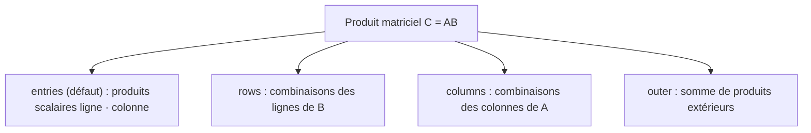

# 02. Vecteurs, matrices et métriques

Les classes [`Vector`](../src/linalg_pedagopy/objects/vector.py) et [`Matrix`](../src/linalg_pedagopy/objects/matrix.py) incarnent les structures de données fondamentales de `linalg_pedagopy`.

Conformément à la philosophie du package :
- **Immutabilité absolue** : Toute opération renvoie une nouvelle instance. Aucune modification en place n'est autorisée.
- **Exactitude symbolique** : Les coefficients sont convertis en expressions SymPy exactes (`sp.Expr`).
- **Protection anti-triche** : Les constructeurs rejettent les proxys verrouillés du tuteur pour empêcher les contournements.

---

## 1. La classe `Vector`

Un `Vector` représente un vecteur colonne de $\mathbb{R}^n$ (de dimension formelle $n \times 1$).

### 1.1 Initialisation et constructeurs d'usine

```python
from linalg_pedagopy import Vector
import sympy as sp
from fractions import Fraction

# Initialisation par une séquence de scalaires exacts
v = Vector([1, "2/3", Fraction(4, 5), sp.sqrt(3)])
print(v)          # (1, 2/3, 4/5, sqrt(3))
print(v.size)     # 4
print(v.shape)    # (4, 1)

# Constructeurs d'usine remarquables
z = Vector.zeros(3)          # Vecteur nul (0, 0, 0)
u = Vector.ones(4)           # Vecteur tout à 1 (1, 1, 1, 1)
e2 = Vector.unit(1, 4)       # 2e vecteur de la base canonique e₂ = (0, 1, 0, 0) (indice 0-based)

# Combinaison linéaire  2·e₁ − 1·e₂
c = Vector.combination([Vector([1, 0]), Vector([0, 1])], [2, -1])
print(c)          # (2, -1)
```

### 1.2 Opérations algébriques

```python
v1 = Vector([1, 2, 3])
v2 = Vector([4, 5, 6])

# Addition et soustraction
w1 = v1 + v2       # (5, 7, 9)
w2 = v1 - v2       # (-3, -3, -3)

# Multiplication scalaire (gauche et droite)
w3 = 3 * v1        # (3, 6, 9)
w4 = v1 * "1/2"    # (1/2, 1, 3/2)

# Division par un scalaire et négation
w5 = v1 / 2        # (1/2, 1, 3/2)
w6 = -v1           # (-1, -2, -3)

# Accès aux coefficients
print(v1[0], len(v1), list(v1))  # 1 3 [1, 2, 3]
```

### 1.3 Métriques et géométrie

`linalg_pedagopy` implémente les métriques géométriques et statistiques usuelles sur les vecteurs :

| Méthode | Définition mathématique | Description |
| :--- | :--- | :--- |
| `v.dot(w)` | $\langle v, w \rangle = \sum_{i=1}^n v_i w_i$ | Produit scalaire standard (l'opérateur `@` n'est pas défini entre deux vecteurs). |
| `v.norm_sq()` | $\|v\|^2 = \sum_{i=1}^n v_i^2$ | Carré de la norme euclidienne (rationnel si $v \in \mathbb{Q}^n$). |
| `v.norm()` | $\|v\| = \sqrt{\langle v, v \rangle}$ | Norme euclidienne exacte. |
| `v.distance(w)` | $\|v - w\|$ | Distance euclidienne entre $v$ et $w$. |
| `v.rms()` | $\text{rms}(v) = \frac{\|v\|}{\sqrt{n}}$ | Valeur efficace (*Root-Mean-Square*). |
| `v.avg()` | $\bar{v} = \frac{1}{n} \sum_{i=1}^n v_i$ | Moyenne arithmétique des coefficients. |
| `v.demean()` | $v - \bar{v}\mathbf{1}$ | Vecteur centré (*de-meaned*). |
| `v.std()` | $\sqrt{\frac{1}{n} \sum (v_i - \bar{v})^2}$ | Écart-type (écart quadratique moyen à la moyenne). |
| `v.angle(w)` | $\theta = \arccos\left(\frac{\langle v, w \rangle}{\|v\| \|w\|}\right)$ | Angle non orienté en radians. |
| `v.correlation(w)` | $\rho = \frac{\langle v - \bar{v}, w - \bar{w} \rangle}{\|v - \bar{v}\| \|w - \bar{w}\|}$ | Coefficient de corrélation de Pearson. |
| `v.is_zero()` | $v = 0$ | Test de nullité exact (via l'oracle). |

> Il n'existe pas de méthode de projection dédiée : la projection sur $\text{Vect}(w)$ s'écrit directement `(v.dot(w) / w.norm_sq()) * w`, ce qui garde la formule visible pour l'étudiant.

Exemple :

```python
a = Vector([1, 2, 2])
b = Vector([2, 0, 1])

print(a.norm())                   # 3
print(a.dot(b))                   # 4
print(a.angle(b))                 # acos(4*sqrt(5)/15)
print(a.distance(b))              # sqrt(6)
print(a.avg(), a.rms(), a.std())  # 5/3 sqrt(3) sqrt(2)/3
print(a.correlation(b))           # -sqrt(3)/2

proj = (a.dot(b) / b.norm_sq()) * b
print(proj)                       # (8/5, 0, 4/5)
print(a - proj)                   # (-3/5, 2, 6/5)
```

### 1.4 Vecteurs empilés et conversions

```python
from linalg_pedagopy import Matrix

# Empilement vertical : via Matrix.block, puis extraction de la colonne
v_block = Matrix.block([[Vector([1, 2])], [Vector([3, 4, 5])]]).col(0)
print(v_block)  # (1, 2, 3, 4, 5)

# Conversions
M = Matrix.from_columns([a])  # Matrix 3x1
sp_col = a.to_sympy()          # sympy.Matrix 3x1
print(a.entries)               # (1, 2, 2)
```

---

## 2. La classe `Matrix`

Une [`Matrix`](../src/linalg_pedagopy/objects/matrix.py) représente une matrice $m \times n$ sur $\mathbb{R}$.

### 2.1 Initialisation et constructeurs d'usine

```python
from linalg_pedagopy import Matrix

# Initialisation par une liste de lignes
A = Matrix([
    [1, 2, 3],
    [4, 5, 6]
])
print(A.shape)   # (2, 3)
print(A.rows)    # 2 (nombre de lignes)
print(A.cols)    # 3 (nombre de colonnes)

# Constructeurs d'usine
I3 = Matrix.identity(3)        # Matrice identité 3x3
Z = Matrix.zeros(2, 4)         # Matrice nulle 2x4
D = Matrix.diag([2, -1, 5])    # Matrice diagonale diag(2, -1, 5)
U = Matrix.ones(2, 3)          # Matrice 2x3 dont tous les coefficients valent 1

# Construction à partir de colonnes ou de lignes
col1 = Vector([1, 0])
col2 = Vector([2, 3])
M = Matrix.from_columns([col1, col2])   # colonnes (1, 0) et (2, 3)
N = Matrix.from_rows([col1, col2])      # lignes (1, 0) et (2, 3), soit la transposée de M
```

### 2.2 Opérations matricielles usuelles

```python
A = Matrix([[1, 2], [3, 4]])
B = Matrix([[2, 0], [1, 2]])

# Somme, différence et multiplication par un scalaire
C = A + B
D = A - B
E = 2 * A

# Produit matriciel (opérateur @), y compris matrice × vecteur
P = A @ B                  # Matrix([[4, 4], [10, 8]])
y = A @ Vector([1, 1])     # Vector (3, 7)

# Transposée et matrice de Gram
AT = A.T                   # Matrix([[1, 3], [2, 4]])
G = A.gram()               # AᵀA = Matrix([[10, 14], [14, 20]])

# Pas d'opérateur ** : les puissances s'écrivent par produits successifs
A_cubed = A @ A @ A
```

### 2.3 Accès aux coefficients, aux lignes et aux colonnes

Les indices commencent à 0 (voir le [guide 01, § 5.3](01_noyau_calcul_formel.md#53-indices-a-partir-de-0-dans-lapi-a-partir-de-1-dans-les-traces)). Une `Matrix` est immuable : les accesseurs renvoient des copies.

```python
A = Matrix([[1, 2, 3], [4, 5, 6]])

print(A[0, 1])                 # coefficient de la ligne 0 et de la colonne 1
#> 2
print(repr(A[:, 1:]))          # tranches : sous-matrice
#> Matrix([[2, 3], [5, 6]])
print(A.row(1), A.col(2))      # une ligne ou une colonne, en Vector
#> (4, 5, 6) (3, 6)
print(A.columns())             # toutes les colonnes ; rows_as_vectors() pour les lignes
#> (Vector([1, 4]), Vector([2, 5]), Vector([3, 6]))
print(repr(A.augment(Vector([7, 8]))))   # matrice augmentée [A | b]
#> Matrix([[1, 2, 3, 7], [4, 5, 6, 8]])
print(A.entries_grid, A.flat_entries)    # coefficients SymPy, par lignes ou à plat
#> ((1, 2, 3), (4, 5, 6)) (1, 2, 3, 4, 5, 6)
```

`A[i]` renvoie la ligne `i` en tuple de coefficients, et `A.row(i)` la même ligne en `Vector`. Un indice hors bornes lève `IndexError`.

Pour les matrices à paramètres, `subs` remplace des paramètres par des valeurs ; les clés peuvent être des symboles ou des noms (voir le [guide 01, § 2.2](01_noyau_calcul_formel.md#22-parametres-designes-par-leur-nom)). `to_sympy()` convertit en `sympy.Matrix`, et `to_domain_matrix()` en `DomainMatrix` sur le plus petit domaine exact (pour les calculs internes rapides) :

```python
from linalg_pedagopy import symbols

a, = symbols("a")
M = Matrix([[1, a], [a, 1]])
print(repr(M.subs({a: 2})), repr(M.subs({"a": 0})))
#> Matrix([[1, 2], [2, 1]]) Matrix([[1, 0], [0, 1]])
```

---

## 3. Les 4 vues du produit matriciel

Un cours d'algèbre linéaire appliquée insiste sur quatre interprétations équivalentes du produit matriciel $C = A B$. `linalg_pedagopy` les rend explicites avec `A.matmul(B, view=...)` : le résultat est le même quelle que soit la vue, mais la trace détaille le calcul selon la vue choisie.



### 3.1 Vue `entries` (par défaut) : produits scalaires ligne · colonne

Chaque coefficient $c_{ij}$ est le produit scalaire de la $i$-ième ligne de $A$ et de la $j$-ième colonne de $B$ :
$$c_{ij} = \sum_{k=1}^n a_{ik} b_{kj}$$

### 3.2 Vue `rows` : combinaisons linéaires des lignes de $B$

La $i$-ième ligne de $C$ est une combinaison des lignes $b_1^T, \dots, b_n^T$ de $B$, avec pour coefficients la $i$-ième ligne de $A$ :
$$\text{ligne}_i(C) = \sum_{k=1}^n a_{ik}\, b_k^T$$

### 3.3 Vue `columns` : combinaisons linéaires des colonnes de $A$

La $j$-ième colonne de $C$ est une combinaison des colonnes $a_1, \dots, a_n$ de $A$, avec pour coefficients la $j$-ième colonne de $B$ :
$$c_j = A b_j = \sum_{k=1}^n b_{kj}\, a_k$$

### 3.4 Vue `outer` : somme de produits extérieurs

Le produit $A B$ est la somme de $n$ matrices de rang au plus 1, produits d'une colonne de $A$ par une ligne de $B$ :
$$A B = \sum_{k=1}^n a_k b_k^T$$

Pour voir la trace d'une vue, on enregistre le calcul avec `tracing` puis on l'affiche :

```python
from linalg_pedagopy import Matrix, tracing
from linalg_pedagopy.render.explanation import Explanation

A = Matrix([[1, 2], [3, 4]])
B = Matrix([[2, 0], [1, 2]])
with tracing(level=2) as tr:
    C = A.matmul(B, view="rows")
print(Explanation(tr.tree).to_text(level=2))
#> Produit matriciel (2×2) @ (2×2) — vue par lignes (combinaisons linéaires des lignes de B).
#> ├─ Ligne 1 du produit : combinaison des lignes de B avec les coefficients (1, 2) -> ( 4, 4 ).
#> ├─ Ligne 2 du produit : combinaison des lignes de B avec les coefficients (3, 4) -> ( 10, 8 ).
#> └─ Résultat du produit matriciel : [(4 4); (10 8)].
print(C == A @ B)   # True
```

### 3.5 Matrices par blocs

La méthode de classe [`Matrix.block`](../src/linalg_pedagopy/objects/matrix.py) assemble une matrice à partir d'une grille de blocs sous-matriciels :

```python
A11 = Matrix([[1, 2], [3, 4]])
A12 = Matrix([[0], [0]])
A21 = Matrix([[5, 6]])
A22 = Matrix([[7]])

M_bloc = Matrix.block([
    [A11, A12],
    [A21, A22]
])
print(repr(M_bloc))   # Matrix([[1, 2, 0], [3, 4, 0], [5, 6, 7]])
```

---

## 4. Analyse et Propriétés des Matrices

### 4.1 Tests structurels

`Matrix` ne fournit pas de prédicats `is_square`, `is_symmetric`… : on les écrit à partir des attributs, ce qui garde la définition sous les yeux.

```python
M = Matrix([[1, 0], [0, 1]])
print(M.rows == M.cols)                  # True  (carrée)
print(M == M.T)                          # True  (symétrique)
print(M.has_orthonormal_columns())       # True  (MᵀM = I)
print(M.rank() == M.rows)                # True  (inversible)
```

### 4.2 Inversion formelle (`inv`)

La méthode [`inv(*, assumptions=None, strict=True)`](../src/linalg_pedagopy/objects/matrix.py) calcule l'inverse symbolique exacte via la réduction de Gauss-Jordan augmentée :
- Si la matrice est numérique et singulière, elle lève (avec `strict=True`, par défaut) une [`SingularMatrixError`](../src/linalg_pedagopy/core/exceptions.py).
- Si la matrice contient des paramètres et reste inversible pour toute valeur, l'inverse est renvoyée directement.
- Si certaines valeurs des paramètres la rendent singulière, `strict=True` lève aussi `SingularMatrixError`, dont le message donne le déterminant et ces valeurs (calculés par la méthode de Bareiss, voir § 4.5) : « det A = -(a - 1)*(a + 1) s'annule pour a = 1 ou a = −1 ». Avec `strict=False`, on obtient un [`CaseSplit`](../src/linalg_pedagopy/core/cases.py) dont les branches singulières ont pour résultat `None`.

```python
from linalg_pedagopy import Matrix, symbols

a, = symbols("a")
A = Matrix([[1, a], [0, 1]])
print(repr(A.inv()))   # Matrix([[1, -a], [0, 1]])  (déterminant 1 : aucun cas particulier)

B = Matrix([[1, a], [a, 1]])
inv_B = B.inv(strict=False)    # CaseSplit : inversible si a ≠ ±1
print(type(inv_B).__name__)    # CaseSplit
for br in inv_B.branches:
    print(br.condition, "->", "singulière" if br.result is None else "inversible")
# a ≠ 1 et a ≠ −1 -> inversible
# a = 1 -> singulière
# a = −1 -> singulière
```

### 4.3 Réduction échelonnée, rang et sous-espaces fondamentaux

Les méthodes [`rref`](../src/linalg_pedagopy/objects/matrix.py), [`rank`](../src/linalg_pedagopy/objects/matrix.py) et [`nullspace`](../src/linalg_pedagopy/objects/matrix.py) acceptent un paramètre `assumptions` pour spécifier des contraintes de branche. Avec des paramètres, elles renvoient une discussion par cas (`CaseSplit`) :

```python
a, = symbols("a")
P = Matrix([[1, a], [a, 1]])
print(P.rank())
#> Discussion selon a
#> ├─ Cas a ≠ 1 et a ≠ −1 (générique) : 2
#> └─ Cas a = 1 ou a = −1 : 1
print(P.rank(assumptions="a != 1"))
#> Discussion selon a
#> ├─ Cas a ≠ 1 et a ≠ −1 (générique) : 2
#> └─ Cas a = −1 : 1
```

Sans paramètre, le résultat est direct :

```python
A = Matrix([
    [1, 2, 0, 1],
    [0, 1, 1, 0],
    [1, 3, 1, 1]
])

print(A.rank())        # 2
R = A.rref()           # Matrix (et non un tuple)
print(repr(R))         # Matrix([[1, 0, -2, 1], [0, 1, 1, 0], [0, 0, 0, 0]])

# Base du noyau (Ker A) : tuple de vecteurs
ker = A.nullspace()
print(ker)             # (Vector([2, -1, 1, 0]), Vector([-1, 0, 0, 1]))

# Colonnes pivots et base de l'image (Col A) via GaussJordan
from linalg_pedagopy import GaussJordan
gj = GaussJordan(A).run()
print(gj.pivots)                          # (0, 1) : indices à partir de 0 (la trace écrit « colonnes pivots = (1, 2) »)
im = [A.col(j) for j in gj.pivots]
print(im)                                 # colonnes pivots de A
```

### 4.4 Résolution directe (`solve`)

`A.solve(b, *, assumptions=None, strict=False)` résout $A x = b$ par Gauss-Jordan et renvoie seulement l'ensemble des solutions (`UniqueSolution`, `AffineSolution` ou `EmptySolution`, décrits dans le [guide 03, § 2.2](03_algorithmes_traces.md)), ou une discussion par cas. Pour la trace et les autres résultats (rang, pivots, forme échelonnée), utilisez `GaussJordan(A, b).run()`.

```python
M = Matrix([[1, a], [a, 1]])
print(M.solve(Vector([1, 1])))
#> Discussion selon a
#> ├─ Cas a ≠ 1 et a ≠ −1 (générique) : UniqueSolution(x=(1/(a + 1), 1/(a + 1)))
#> ├─ Cas a = 1 : (1, 0) + t_1·(-1, 1)
#> └─ Cas a = −1 : EmptySolution(ligne L2 : 0 = 2)
print(M.solve(Vector([1, 1]), assumptions={"a": 3}))
#> UniqueSolution(x=(1/4, 1/4))
print(Matrix([[1, 1], [2, 2]]).solve(Vector([1, 3])))
#> EmptySolution(ligne L2 : 0 = 1)
```

Le second membre peut aussi être une matrice $B$ (plusieurs seconds membres) : la solution $X$ de $A X = B$ est alors une matrice.

### 4.5 Déterminant (`det`)

La méthode [`det(*, method="auto", assumptions=None)`](../src/linalg_pedagopy/objects/matrix.py) renvoie le déterminant exact, factorisé. Elle délègue à la procédure [`Determinant`](../src/linalg_pedagopy/algorithms/determinant.py), décrite dans le [guide 03](03_algorithmes_traces.md) (méthodes de Bareiss, élimination, cofacteurs, Sarrus ; trace pas à pas ; valeurs singulières du paramètre).

```python
from linalg_pedagopy import Matrix, symbols

a, = symbols("a")
print(Matrix([[a, 1, 1], [1, a, 1], [1, 1, a]]).det())   # (a - 1)**2*(a + 2)
print(Matrix([[2, 1, 3], [0, 4, 5], [1, 0, 6]]).det())   # 41
print(Matrix([[1, a], [a, 1]]).det())                    # -(a - 1)*(a + 1) : singulière si a = ±1
```

---

## 5. Matrices structurées classiques (`linalg_pedagopy.special`)

Les matrices que l'on rencontre dans tout cours d'algèbre linéaire appliquée se construisent directement, en arithmétique exacte. Les indices de composantes sont comptés **à partir de 0**, comme pour `Vector.unit`. Chaque fonction est importable depuis `linalg_pedagopy` et possède un alias français.

| Fonction | Alias français | Matrice obtenue |
| :--- | :--- | :--- |
| `difference_matrix(n)` | `matrice_differences` | $(n-1) \times n$, $(D x)_i = x_{i+1} - x_i$ |
| `running_sum_matrix(n)` | `matrice_somme_cumulee` | $n \times n$ triangulaire inférieure de 1, $(S x)_i = x_1 + \dots + x_i$ |
| `moving_average_matrix(n, k)` | `matrice_moyenne_glissante` | $(n-k+1) \times n$, moyenne de $k$ valeurs consécutives |
| `vandermonde(points, degree=None)` | `vandermonde` | ligne $i$ : $(1, t_i, t_i^2, \dots)$ |
| `convolution_matrix(b, n)` | `matrice_convolution` | Toeplitz $T(b)$ telle que $T(b)\,a = b * a$ |
| `convolution(a, b)` | `convolution` | le vecteur $a * b$ (produit des polynômes associés) |
| `selection_matrix(indices, n)` | `matrice_selection` | lignes $e_{i}^T$ pour les indices choisis |
| `reversal_matrix(n)` | `matrice_renversement` | $(x_n, \dots, x_1)$ |

```python
from linalg_pedagopy import (
    Vector, difference_matrix, running_sum_matrix, moving_average_matrix,
    vandermonde, convolution, convolution_matrix, selection_matrix, reversal_matrix,
)

D = difference_matrix(4)          # 3 × 4
S = running_sum_matrix(4)         # 4 × 4
print((D @ S).entries_grid)       # ((0, 1, 0, 0), (0, 0, 1, 0), (0, 0, 0, 1)) : D « défait » S

print(moving_average_matrix(5, 3).entries_grid[0])   # (1/3, 1/3, 1/3, 0, 0)

V = vandermonde([0, 1, 2])        # valeurs d'un polynôme de degré 2 aux points 0, 1, 2
print(V @ Vector([1, -1, 2]))     # (1, 2, 7) : p(t) = 1 − t + 2t²

print(convolution([1, -2, 1], [2, 1]))                 # (2, -3, 0, 1)
print(convolution_matrix([2, 1], 3) @ Vector([1, -2, 1]))  # même résultat

print(selection_matrix([1, 3], 5) @ Vector([10, 11, 12, 13, 14]))  # (11, 13)
print(reversal_matrix(3) @ Vector([1, 2, 3]))                       # (3, 2, 1)
```

> Ces matrices sont aussi des **réponses** possibles aux exercices de modélisation du tuteur : elles permettent de vérifier un résultat, pas de le donner à l'étudiant à sa place.
