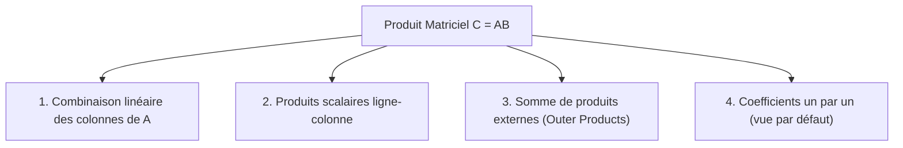

# 02. Vecteurs, Matrices et Métriques VMLS

Les classes [`Vector`](../src/linalg_pedagopy/objects/vector.py) et [`Matrix`](../src/linalg_pedagopy/objects/matrix.py) incarnent les structures de données fondamentales de `linalg_pedagopy`.

Conformément à la philosophie du package :
- **Immutabilité absolue** : Toute opération renvoie une nouvelle instance. Aucune modification en place n'est autorisée.
- **Exactitude symbolique** : Les coefficients sont convertis en expressions SymPy exactes (`sp.Expr`).
- **Protection anti-triche** : Les constructeurs rejettent les proxys verrouillés du tuteur pour empêcher les contournements.

---

## 1. La classe `Vector`

Un `Vector` représente un vecteur colonne de $\mathbb{R}^n$ (de dimension formelle $n \times 1$).

### 1.1 Initialisation et constructeurs d'usine

```python
from linalg_pedagopy import Vector
import sympy as sp
from fractions import Fraction

# Initialisation par une séquence de scalaires exacts
v = Vector([1, "2/3", Fraction(4, 5), sp.sqrt(3)])
print(v)          # (1, 2/3, 4/5, sqrt(3))
print(v.size)     # 4
print(v.shape)    # (4, 1)

# Constructeurs d'usine remarquables
z = Vector.zeros(3)          # Vecteur nul (0, 0, 0)
u = Vector.ones(4)           # Vecteur tout à 1 (1, 1, 1, 1)
e2 = Vector.unit(1, 4)       # 2e vecteur de la base canonique e₂ = (0, 1, 0, 0) (indice 0-based)

# Combinaison linéaire  2·e₁ − 1·e₂
c = Vector.combination([Vector([1, 0]), Vector([0, 1])], [2, -1])
print(c)          # (2, -1)
```

### 1.2 Opérations algébriques

```python
v1 = Vector([1, 2, 3])
v2 = Vector([4, 5, 6])

# Addition et soustraction
w1 = v1 + v2       # (5, 7, 9)
w2 = v1 - v2       # (-3, -3, -3)

# Multiplication scalaire (gauche et droite)
w3 = 3 * v1        # (3, 6, 9)
w4 = v1 * "1/2"    # (1/2, 1, 3/2)

# Division par un scalaire et négation
w5 = v1 / 2        # (1/2, 1, 3/2)
w6 = -v1           # (-1, -2, -3)

# Accès aux coefficients
print(v1[0], len(v1), list(v1))  # 1 3 [1, 2, 3]
```

### 1.3 Métriques et géométrie VMLS

`linalg_pedagopy` implémente l'ensemble des métriques géométriques introduites dans les chapitres 1 à 3 de *VMLS* :

| Méthode | Définition Mathématique | Description VMLS |
| :--- | :--- | :--- |
| `v.dot(w)` | $\langle v, w \rangle = \sum_{i=1}^n v_i w_i$ | Produit scalaire standard (l'opérateur `@` n'est pas défini entre deux vecteurs). |
| `v.norm_sq()` | $\|v\|^2 = \sum_{i=1}^n v_i^2$ | Carré de la norme euclidienne (rationnel si $v \in \mathbb{Q}^n$). |
| `v.norm()` | $\|v\| = \sqrt{\langle v, v \rangle}$ | Norme euclidienne exacte. |
| `v.distance(w)` | $\|v - w\|$ | Distance euclidienne entre $v$ et $w$. |
| `v.rms()` | $\text{rms}(v) = \frac{\|v\|}{\sqrt{n}}$ | Valeur efficace (*Root-Mean-Square*). |
| `v.avg()` | $\bar{v} = \frac{1}{n} \sum_{i=1}^n v_i$ | Moyenne arithmétique des coefficients. |
| `v.demean()` | $v - \bar{v}\mathbf{1}$ | Vecteur centré (*de-meaned*). |
| `v.std()` | $\sqrt{\frac{1}{n} \sum (v_i - \bar{v})^2}$ | Écart-type (écart quadratique moyen à la moyenne). |
| `v.angle(w)` | $\theta = \arccos\left(\frac{\langle v, w \rangle}{\|v\| \|w\|}\right)$ | Angle non orienté en radians. |
| `v.correlation(w)` | $\rho = \frac{\langle v - \bar{v}, w - \bar{w} \rangle}{\|v - \bar{v}\| \|w - \bar{w}\|}$ | Coefficient de corrélation de Pearson. |
| `v.is_zero()` | $v = 0$ | Test de nullité exact (via l'oracle). |

> Il n'existe pas de méthode de projection dédiée : la projection sur $\text{Vect}(w)$ s'écrit directement `(v.dot(w) / w.norm_sq()) * w`, ce qui garde la formule visible pour l'étudiant.

Exemple :

```python
a = Vector([1, 2, 2])
b = Vector([2, 0, 1])

print(a.norm())                   # 3
print(a.dot(b))                   # 4
print(a.angle(b))                 # acos(4*sqrt(5)/15)
print(a.distance(b))              # sqrt(6)
print(a.avg(), a.rms(), a.std())  # 5/3 sqrt(3) sqrt(2)/3
print(a.correlation(b))           # -sqrt(3)/2

proj = (a.dot(b) / b.norm_sq()) * b
print(proj)                       # (8/5, 0, 4/5)
print(a - proj)                   # (-3/5, 2, 6/5)
```

### 1.4 Vecteurs empilés et conversions

```python
from linalg_pedagopy import Matrix

# Empilement vertical : via Matrix.block, puis extraction de la colonne
v_block = Matrix.block([[Vector([1, 2])], [Vector([3, 4, 5])]]).col(0)
print(v_block)  # (1, 2, 3, 4, 5)

# Conversions
M = Matrix.from_columns([a])  # Matrix 3x1
sp_col = a.to_sympy()          # sympy.Matrix 3x1
print(a.entries)               # (1, 2, 2)
```

---

## 2. La classe `Matrix`

Une [`Matrix`](../src/linalg_pedagopy/objects/matrix.py) représente une matrice $m \times n$ sur $\mathbb{R}$.

### 2.1 Initialisation et constructeurs d'usine

```python
from linalg_pedagopy import Matrix

# Initialisation par une liste de lignes
A = Matrix([
    [1, 2, 3],
    [4, 5, 6]
])
print(A.shape)   # (2, 3)
print(A.rows)    # 2 (nombre de lignes)
print(A.cols)    # 3 (nombre de colonnes)

# Constructeurs d'usine
I3 = Matrix.identity(3)        # Matrice identité 3x3
Z = Matrix.zeros(2, 4)         # Matrice nulle 2x4
D = Matrix.diag([2, -1, 5])    # Matrice diagonale diag(2, -1, 5)

# Construction à partir de colonnes ou de lignes
col1 = Vector([1, 0])
col2 = Vector([2, 3])
M = Matrix.from_columns([col1, col2])
```

### 2.2 Opérations matricielles usuelles

```python
A = Matrix([[1, 2], [3, 4]])
B = Matrix([[2, 0], [1, 2]])

# Somme, différence et multiplication par un scalaire
C = A + B
D = A - B
E = 2 * A

# Produit matriciel (opérateur @), y compris matrice × vecteur
P = A @ B                  # Matrix([[4, 4], [10, 8]])
y = A @ Vector([1, 1])     # Vector (3, 7)

# Transposée et matrice de Gram
AT = A.T                   # Matrix([[1, 3], [2, 4]])
G = A.gram()               # AᵀA = Matrix([[10, 14], [14, 20]])

# Pas d'opérateur ** : les puissances s'écrivent par produits successifs
A_cubed = A @ A @ A
```

---

## 3. Les 4 vues du produit matriciel (VMLS §10.1)

L'ouvrage *VMLS* insiste sur quatre interprétations équivalentes mais conceptuellement distinctes du produit matriciel $C = A B$. `linalg_pedagopy` les rend explicites via `A.matmul(B, view=...)` : le résultat est identique quelle que soit la vue, mais la trace enregistrée (section `matrix.matmul.<vue>`) détaille le calcul selon la vue choisie :



### 3.1 Vue 1 (`view='columns'`) : Combinaisons linéaires des colonnes de $A$

Chaque colonne $c_j$ de $C$ est une combinaison linéaire des colonnes $a_1, \dots, a_n$ de $A$, avec pour coefficients les composantes de la $j$-ième colonne de $B$ :
$$c_j = A b_j = \sum_{i=1}^n b_{ij} a_i$$

### 3.2 Vue 2 (`view='rows'` / `view='entries'`) : Produits scalaires ligne-colonne

Chaque coefficient $c_{ij}$ est le produit scalaire standard entre la $i$-ième ligne de $A$ et la $j$-ième colonne de $B$ :
$$c_{ij} = \text{row}_i(A) \cdot \text{col}_j(B) = \sum_{k=1}^n a_{ik} b_{kj}$$

### 3.3 Vue 3 (`view='outer'`) : Somme de produits externes (*Outer Products*)

Le produit $A B$ est la somme de $n$ matrices de rang 1 formées par les produits externes des colonnes de $A$ et des lignes de $B$ :
$$A B = \sum_{k=1}^n a_k b_k^T$$

```python
from linalg_pedagopy import tracing

A = Matrix([[1, 2], [3, 4]])
B = Matrix([[2, 0], [1, 2]])
with tracing(level=2):
    C = A.matmul(B, view="outer")
print(C == A @ B)   # True
```

### 3.4 Matrices par blocs

La méthode de classe [`Matrix.block`](../src/linalg_pedagopy/objects/matrix.py) assemble une matrice à partir d'une grille de blocs sous-matriciels :

```python
A11 = Matrix([[1, 2], [3, 4]])
A12 = Matrix([[0], [0]])
A21 = Matrix([[5, 6]])
A22 = Matrix([[7]])

M_bloc = Matrix.block([
    [A11, A12],
    [A21, A22]
])
print(M_bloc)
# [1, 2, 0]
# [3, 4, 0]
# [5, 6, 7]
```

---

## 4. Analyse et Propriétés des Matrices

### 4.1 Tests structurels

`Matrix` ne fournit pas de prédicats `is_square`, `is_symmetric`… : on les écrit à partir des attributs, ce qui garde la définition sous les yeux.

```python
M = Matrix([[1, 0], [0, 1]])
print(M.rows == M.cols)                  # True  (carrée)
print(M == M.T)                          # True  (symétrique)
print(M.has_orthonormal_columns())       # True  (MᵀM = I)
print(M.rank() == M.rows)                # True  (inversible)
```

### 4.2 Inversion formelle (`inv`)

La méthode [`inv(*, assumptions=None, strict=True)`](../src/linalg_pedagopy/objects/matrix.py) calcule l'inverse symbolique exacte via la réduction de Gauss-Jordan augmentée :
- Si la matrice est numérique et singulière, elle lève (avec `strict=True`, par défaut) une [`SingularMatrixError`](../src/linalg_pedagopy/core/exceptions.py).
- Si la matrice contient des paramètres et reste inversible pour toute valeur, l'inverse est renvoyée directement.
- Si certaines valeurs des paramètres la rendent singulière, `strict=True` lève aussi `SingularMatrixError` ; avec `strict=False`, on obtient un [`CaseSplit`](../src/linalg_pedagopy/core/cases.py) dont les branches singulières ont pour résultat `None`.

```python
from linalg_pedagopy import Matrix, symbols

a, = symbols("a")
A = Matrix([[1, a], [0, 1]])
print(A.inv()) # Matrix([[1, -a], [0, 1]])  (déterminant 1 : aucun cas particulier)

B = Matrix([[1, a], [a, 1]])
inv_B = B.inv(strict=False)    # CaseSplit : inversible si a ≠ ±1
print(type(inv_B).__name__)    # CaseSplit
for br in inv_B.branches:
    print(br.condition, "->", "singulière" if br.result is None else "inversible")
# a ≠ 1 et a ≠ -1 -> inversible
# a = 1 -> singulière
# a = -1 -> singulière
```

### 4.3 Réduction échelonnée, rang et sous-espaces fondamentaux

Les méthodes [`rref`](../src/linalg_pedagopy/objects/matrix.py), [`rank`](../src/linalg_pedagopy/objects/matrix.py) et [`nullspace`](../src/linalg_pedagopy/objects/matrix.py) acceptent un paramètre `assumptions` pour spécifier des contraintes de branche :

```python
A = Matrix([
    [1, 2, 0, 1],
    [0, 1, 1, 0],
    [1, 3, 1, 1]
])

print(A.rank())        # 2
R = A.rref()           # Matrix (et non un tuple)
print(R)               # [[1, 0, -2, 1], [0, 1, 1, 0], [0, 0, 0, 0]]

# Base du noyau (Ker A) : tuple de vecteurs
ker = A.nullspace()
print(ker)             # (Vector([2, -1, 1, 0]), Vector([-1, 0, 0, 1]))

# Colonnes pivots et base de l'image (Col A) via GaussJordan
from linalg_pedagopy import GaussJordan
gj = GaussJordan(A).run()
print(gj.pivots)                          # (0, 1)
im = [A.col(j) for j in gj.pivots]
print(im)                                 # colonnes pivots de A
```
