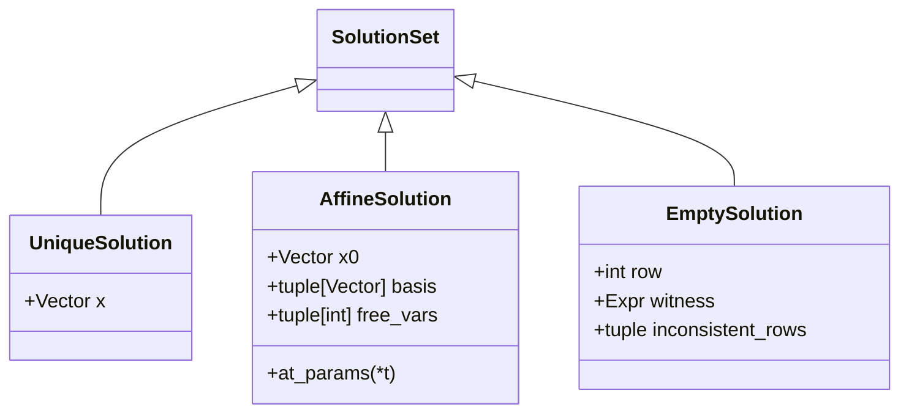

# 03. Algorithmes fondamentaux et Traçabilité hiérarchique

Le module `linalg_pedagopy.algorithms` regroupe les procédures fondamentales de l'algèbre linéaire telles qu'on les enseigne en L1–L2, avec une trace pas à pas de chaque calcul.

Chaque procédure hérite de la classe de base [`Procedure`](../src/linalg_pedagopy/algorithms/base.py) et s'exécute dans un contexte de traçabilité pédagogique.

---

## 1. Moteur de traçabilité contextuelle (`Tracer`)

### 1.1 Pourquoi une traçabilité hiérarchique ?

L'apprentissage de l'algèbre linéaire ne consiste pas seulement à obtenir une réponse numérique brute, mais à comprendre la succession d'étapes de calcul. Cependant, un niveau d'explication unique ne convient pas à tous les publics :
- Un enseignant qui projette au tableau veut les opérations de lignes et les matrices obtenues.
- Un étudiant en TD a besoin, en plus, du découpage colonne par colonne et du choix de chaque pivot.
- Pour comprendre une discussion par cas, il faut voir les tests de nullité qui l'ont déclenchée.

`linalg_pedagopy` résout ce dilemme par un **traceur arborescent** : chaque appel à `run()` enregistre la trace **complète** (jusqu'au niveau 3) dans `result.trace`, et c'est au moment de l'affichage que l'on choisit le niveau de détail avec `result.explain(level=...)` (par défaut `config.default_trace_level`, qui vaut 1) :

```python
from linalg_pedagopy import Matrix, Vector, GaussJordan, tracing

A = Matrix([[2, 1], [4, 3]])
b = Vector([5, 11])

res = GaussJordan(A, b).run()

# Niveau 1 : macro-étapes (opérations de lignes et résultat)
print(res.explain(level=1))

# Niveau 2 : ajoute le choix des pivots et le découpage par colonne
print(res.explain(level=2))

# Niveau 3 : ajoute les contrôles de nullité de l'oracle
print(res.explain(level=3))
```

Le context manager [`tracing`](../src/linalg_pedagopy/trace/tracer.py) sert, lui, à **regrouper** dans un même arbre les étapes de plusieurs calculs successifs, filtrées au niveau indiqué :

```python
with tracing(level=1) as tr:
    GaussJordan(A, b).run()
    GaussJordan(A.T, b).run()
arbre = tr.tree          # Step racine contenant les deux réductions
print(len(arbre.children))
```

### 1.2 Les 4 niveaux de zoom didactiques

| Niveau | Nom | Description du contenu de la trace |
| :---: | :--- | :--- |
| **0** | **Résultat seul** | Aucune étape du calcul : seulement le résumé du résultat (rang, solution, inverse…), comme pour une branche de discussion par cas. |
| **1** | **Macro-étapes** *(défaut)* | Opérations élémentaires sur les lignes ($L_2 \leftarrow L_2 - 2 L_1$) avec la matrice après chaque opération, résultat final. |
| **2** | **Micro-étapes** *(recommandé en TD)* | Ajoute le traitement colonne par colonne, le choix et la stratégie de pivot, la base du noyau, les projections et normalisations. |
| **3** | **Contrôles élémentaires** | Ajoute les tests de nullité de l'oracle (« Ce coefficient est nul dans le domaine exact »), qui expliquent pourquoi une case est sautée ou une discussion ouverte. |

La même trace s'affiche aussi **en tableau**, avec une ligne par opération : `res.explain().to_table()` renvoie un `TraceTable` qui s'affiche en HTML dans JupyterLab et s'exporte en Markdown (`to_markdown()`), en LaTeX (`to_latex()`) ou en HTML (`to_html()`). Pour l'élimination, les colonnes sont **N°**, **Colonne**, **Pivot**, **Opération**, **But** et **Matrice obtenue** ; une discussion par cas donne une section par branche. Le détail des colonnes et l'exemple de Gram-Schmidt sont dans le [guide 06, § 1.2](06_rendering_visualization_and_numerics.md).

```python
table = res.explain().to_table()
print([ligne.text for ligne in table.sections[0].rows if ligne.kind == "op"])
#> ['ramener le pivot à 1', 'annuler le coefficient (2,1)', 'annuler le coefficient (1,2)']
```

### 1.3 Nœuds de l'arbre : `Step`, `StepKind` et `Highlight`

L'arbre de trace est composé de nœuds immuables [`Step`](../src/linalg_pedagopy/trace/step.py). Chaque étape possède :
- Un type d'action [`StepKind`](../src/linalg_pedagopy/trace/step.py) (`SECTION`, `INFO`, `WARNING`, `ROW_SWAP`, `ROW_SCALE`, `ROW_ADD`, `DOT`, `NORM`, `PROJECTION`, `SUBTRACT`, `NORMALIZE`, `BACK_SUBSTITUTION`, `CASE_SPLIT`, `CHECK`, `RESULT`).
- Des instantanés matriciels (`snapshot`).
- Une mise en valeur graphique [`Highlight`](../src/linalg_pedagopy/trace/step.py) spécifiant les coordonnées du pivot $(i, j)$, les lignes modifiées et la barre de séparation augmentée.

### 1.4 Ce que renvoie `run()` : le contrat commun des résultats

Chaque procédure s'utilise de la même façon : on la construit avec ses données et ses options, puis `run()` renvoie un **résultat typé** (`GJResult`, `TriangularResult`, `GSResult`, `QRResult`, `LSResult`, `DetResult`), ou un `CaseSplit` de ces résultats quand une discussion selon les paramètres est nécessaire (voir le [guide 01, § 4](01_core_and_formal_computation.md)). Tous les résultats partagent :

- `trace` : l'arbre complet des étapes (niveau 3) ;
- `explain(level=None)` : une `Explanation` filtrée au niveau demandé, à afficher (`print`) ou à exporter (`to_text`, `to_markdown`, `to_latex`, `to_html`, `to_table`, `save`) ; voir le [guide 06](06_rendering_visualization_and_numerics.md) ;
- `verify()` : un **contrôle a posteriori**, refait indépendamment du calcul et renvoyé lui aussi sous forme d'`Explanation` ;
- l'affichage automatique dans JupyterLab (Markdown et LaTeX, au niveau 2 au moins).

| Résultat | Ce que vérifie `verify()` |
| :--- | :--- |
| `GJResult` | $A x - b = 0$ pour la solution, et $A v = 0$ pour chaque vecteur de la base du noyau |
| `TriangularResult` | résidu $A x - c$ nul (rien à vérifier dans une branche singulière) |
| `GSResult` | famille orthonormée, ou témoin de dépendance $a_k - \sum_i \lambda_i \tilde q_i = 0$ |
| `QRResult` | $Q R = A$ et $Q^T Q = I_n$, coefficient par coefficient |
| `LSResult` | $A^T \hat r = 0$, colonne par colonne |
| `DetResult` | même déterminant par un algorithme indépendant (Berkowitz, sans division) |

```python
print(res.verify())
#> Vérification a posteriori du résultat de Gauss-Jordan.
#> └─ Contrôle vérifié : A x - b = (0, 0).
```

Les attributs propres à chaque résultat sont décrits avec sa procédure, ci-dessous.

---

## 2. Élimination de Gauss-Jordan (`GaussJordan`)

La procédure [`GaussJordan`](../src/linalg_pedagopy/algorithms/gauss_jordan.py) résout les systèmes linéaires formels $A x = b$ et calcule l'inverse de matrices carrées.

### 2.1 Signature et options

```text
GaussJordan(
    A: Matrix,
    b: Vector | None = None,
    *,
    pivot_strategy: "simplest" | "first" | "partial" | "sparse" = "simplest",
    reduction: "simultaneous" | "back_substitution" = "simultaneous",
    strict: bool = False,
    max_depth: int | None = None,
    max_cases: int | None = None,
    assumptions: Condition | dict | str | list | None = None,
    compute_inverse: bool = False,
)
```

- `A` : Matrice des coefficients $m \times n$.
- `b` : Vecteur second membre (optionnel ; sans lui, seule la RREF de $A$ est calculée).
- `pivot_strategy` : choix du pivot — le plus simple (`"simplest"`), le premier non nul (`"first"`), le plus grand en valeur absolue (`"partial"`) ou celui de la ligne la plus creuse (`"sparse"`, critère de Markowitz : moins de coefficients non nuls à remplir, puis le plus simple).
- `reduction` : `"simultaneous"` annule au-dessus et au-dessous de chaque pivot en une seule passe (Gauss-Jordan) ; `"back_substitution"` échelonne d'abord vers le bas, puis remonte de la dernière colonne pivot à la première (méthode du pivot de Gauss suivie de la remontée), ce qui limite la croissance des expressions intermédiaires sur les matrices bande. La forme réduite obtenue est la même.
- `strict` : si `True`, lève `SingularMatrixError` pour un système incompatible (ou une matrice non inversible avec `compute_inverse=True`) au lieu de renvoyer `EmptySolution` / `inverse=None`.
- `max_depth`, `max_cases` : limites de la discussion paramétrique (par défaut `config.max_case_depth` et `config.max_cases`). Quand une limite est atteinte, `CaseLimitError` (sous-classe de `PedagopyError`) arrête le calcul avec un message qui nomme les facteurs qui ouvrent des cas, la branche en cours, une hypothèse à fournir et un plafond plus élevé :

  ```text
  Discussion par cas arrêtée : elle demande au moins 9 branches, au-delà du plafond max_cases=8.
  Facteurs qui ouvrent des cas : a − 1, a + 1, b − 1, b + 1.
  Branche en cours : a = −1.
  Pour poursuivre : précisez des hypothèses sur les paramètres, par exemple assumptions="a != 1", ou relevez le plafond (max_cases=16, ou config.max_cases = 16).
  ```

  Les mêmes informations sont des attributs de l'exception : `limit`, `value`, `reached`, `factors`, `condition`, `suggested_assumption`.
- **Grandes matrices à paramètres** : au-delà de `config.max_generic_dim` (4 par défaut), Gauss-Jordan sur une matrice qui contient des paramètres émet un `PedagogicalWarning`. Le calcul est mené à terme, mais l'avertissement rappelle qu'une discussion par cas sur une matrice symbolique 5 × 5 est rarement lisible et qu'il vaut mieux chercher d'abord une structure remarquable (triangulaire par blocs, tridiagonale, $aI + bJ$, Vandermonde…). `config.max_generic_dim = None` le supprime ; `warnings.simplefilter("error", PedagogicalWarning)` le transforme en erreur.
- `assumptions` : hypothèses sur les paramètres, sous forme de `Condition`, de chaîne (`"a != 1"`, `"a = 2"`), de liste de chaînes ou de dictionnaire (`{"a": 2}`, `{"a": "!= 1"}`). Seules les égalités et les différences sont prises en compte : une inégalité d'ordre (`"a > 0"`) ou une forme inconnue lève `InvalidAssumptionError`.
- `compute_inverse` : si `True`, calcule l'inverse via l'échelonnement simultané de $[A \mid I_n]$ (champ `inverse` du résultat).

Le résultat `GJResult` expose `A`, `b`, `rref`, `augmented_rref`, `pivots`, `rank`, `free_vars`, `nullspace_basis`, `solution` et `inverse`. `pivots` et `free_vars` sont des indices à partir de 0, alors que la trace numérote colonnes et variables à partir de 1 (« colonnes pivots = (1, 2) », « x2 libre »).

### 2.2 Typologie des ensembles de solutions

Le résultat renvoyé par `GaussJordan.run()` est un [`GJResult`](../src/linalg_pedagopy/algorithms/gauss_jordan.py), ou, si la matrice contient des paramètres, une discussion par cas (`CaseSplit`) dont chaque branche porte un `GJResult`. La propriété `solution` d'un `GJResult` la propriété `solution` appartient à l'une des 3 catégories de [`SolutionSet`](../src/linalg_pedagopy/algorithms/base.py) :



1. **`UniqueSolution`** : Système de Cramer ou système rectangulaire compatible de rang plein colonne.  
   $\mathcal{S} = \{ x_0 \}$.
2. **`AffineSolution`** : Sous-déterminé ou système compatible de rang déficient.  
   $\mathcal{S} = x_p + \text{Vect}(v_1, \dots, v_k)$. L'objet fournit la solution particulière `x0` ($x_p$), une base du noyau `basis` ($\{v_1, \dots, v_k\}$) et les indices des variables libres `free_vars` ; `at_params(t1, ..., tk)` renvoie la solution pour des valeurs données des paramètres.
3. **`EmptySolution`** : Système incompatible (présence d'une ligne d'incompatibilité $[0 \dots 0 \mid \beta]$ avec $\beta \neq 0$).  
   $\mathcal{S} = \emptyset$. L'objet indique la ligne témoin `row` (indice 0-based), la valeur non nulle `witness` du second membre et la liste `inconsistent_rows`.

### 2.3 Exemple avec paramètre et discussion automatique

```python
from linalg_pedagopy import Matrix, Vector, symbols, GaussJordan

m, = symbols("m")
A = Matrix([
    [1, 1, m],
    [1, m, 1],
    [m, 1, 1]
])
b = Vector([1, 1, 1])

res = GaussJordan(A, b).run()
print(res.explain())

for br in res.branches:
    print(br.condition, "->", br.result.solution)
# m ≠ 1 et m ≠ −2 -> UniqueSolution(x=(1/(m + 2), 1/(m + 2), 1/(m + 2)))
# m = −2 -> EmptySolution(ligne L3 : 0 = 3)
# m = 1 -> (1, 0, 0) + t_1·(-1, 1, 0) + t_2·(-1, 0, 1)
```

Ce code produit automatiquement un `CaseSplit` distinguant :
- Le cas $m = 1$ : infinité de solutions (plan affine de dimension 2).
- Le cas $m = -2$ : système incompatible ($\emptyset$).
- Le cas $m \notin \{1, -2\}$ : solution unique $x = \left(\frac{1}{m+2}, \frac{1}{m+2}, \frac{1}{m+2}\right)$.

### 2.4 Base du noyau expliquée

Quand la réduction laisse des variables libres, la trace de niveau 2 explique la base du noyau lue sur la forme réduite. Elle apparaît pour une réduction sans second membre (`rref()`, `rank()`, `nullspace()`), où le noyau est l'objet étudié, et pour une solution affine, dont il donne les directions. Elle n'apparaît pas pour un système incompatible ni pour un calcul d'inverse.

```python
A = Matrix([[1, 2, -1, 3, -1], [2, 4, -1, 7, 1], [-1, -2, 3, -1, 7]])
print(GaussJordan(A).run().explain(level=2))
# ├─ Noyau : variables libres x2, x4, x5 (colonnes sans pivot), variables principales x1, x3 ; dim ker A = n − rg A = 5 − 2 = 3.
# ├─ Système homogène équivalent (variables principales en fonction des variables libres) : x1 = −2·x2 − 4·x4 − 2·x5 ; x3 = −x4 − 3·x5.
# ├─ En posant x2 = 1 et les autres variables libres nulles : v1 = ( −2, 1, 0, 0, 0 ).
# ├─ En posant x4 = 1 et les autres variables libres nulles : v2 = ( −4, 0, −1, 1, 0 ).
# ├─ En posant x5 = 1 et les autres variables libres nulles : v3 = ( −2, 0, −3, 0, 1 ).
# ├─ Les composantes x2, x4, x5 de v1, v2, v3 forment la matrice identité I_3 : [...] c'est une base.
```

La dernière étape répond à une question fréquente : la famille obtenue est libre *par construction*, car ses composantes sur les variables libres forment la matrice identité. Sans variable libre, une réduction sans second membre annonce $\ker A = \{0\}$, de dimension 0, et sa base vide. `Matrix.nullspace()` réduit $A$ seule, sans ajouter de colonne de zéros.

### 2.5 Écriture des résultats selon la condition de la branche

Une condition comme $a^2 - 2 \neq 0$ s'affiche avec ses racines : « $a \neq \sqrt 2$ et $a \neq -\sqrt 2$ ». Pour que la solution se lise avec les **mêmes facteurs**, ses coefficients sont factorisés avec les radicaux de la condition :

```python
a, = symbols("a")
res = GaussJordan(Matrix([[a**2 - 2, 1], [0, a - 1]]), Vector([1, 1])).run()
print(res)
#> Discussion selon a
#> ├─ Cas a ≠ √(2) et a ≠ −√(2) et a ≠ 1 (générique) : pivots non nuls, rang 2, solution unique
#> │    x = ( (a − 2)/((a − 1)·(a − √(2))·(a + √(2))), 1/(a − 1) )
#> ├─ Cas a = 1 : L2 devient (0 0 | 1)
#> │    système incompatible (témoin : 0 = 1)
#> └─ Cas a² − 2 = 0 : L2 devient (0 0 | 2 - a)
#>      système incompatible (témoin : 0 = 2 - a)
```

Seuls les facteurs irréductibles sur $\mathbb{Q}$ sont décomposés, et seulement avec les radicaux qui figurent dans la condition de la branche : $1 - 2a$ garde son écriture. L'option `config.factor_policy = "rational"` (ou `using_config(factor_policy="rational")`) rétablit la factorisation sur $\mathbb{Q}$ seul.

Dans une branche définie par une égalité non linéaire, par exemple $a^2 - 3 = 0$, les coefficients de la forme réduite sont remplacés par leur reste dans la division par $a^2 - 3$ ; une étape de niveau 2 l'annonce. Un témoin d'incompatibilité s'écrit alors $0 = 2$ plutôt que $0 = a^4 - 3a^2 + 2$.

---

## 3. Substitutions triangulaires

Pour un système dont la matrice est **triangulaire et carrée**, les algorithmes de substitution évitent le coût complet d'un pivot de Gauss. Une matrice non carrée lève `DimensionMismatchError`, un coefficient diagonal nul `SingularMatrixError`.

- [`ForwardSubstitution`](../src/linalg_pedagopy/algorithms/triangular.py) : Résout $L y = b$ pour une matrice triangulaire inférieure $L$ (descente).
- [`BackSubstitution`](../src/linalg_pedagopy/algorithms/triangular.py) : Résout $U x = y$ pour une matrice triangulaire supérieure $U$ (remontée).

```python
from linalg_pedagopy import Matrix, Vector, BackSubstitution

U = Matrix([
    [2, 1, -1],
    [0, 3,  2],
    [0, 0,  4]
])
y = Vector([3, 8, 4])

res = BackSubstitution(U, y).run()   # TriangularResult(x, A, c)
print(res.x)  # (1, 2, 1)
```

Si un coefficient diagonal dépend d'un paramètre, la discussion couvre tous les cas : la branche générique donne la solution, et chaque branche où un coefficient diagonal s'annule le signale (`singular`, `singular_index`) au lieu de la solution, car la substitution ne s'y applique pas ; `GaussJordan` discute alors les solutions.

```python
from linalg_pedagopy import symbols

a, = symbols("a")
print(BackSubstitution(Matrix([[1, 2], [0, a]]), Vector([1, 1])).run())
#> Discussion selon a
#> ├─ Cas a ≠ 0 (générique) : x = ((a - 2)/a, 1/a)
#> └─ Cas a = 0 : coefficient diagonal (2,2) nul : système singulier, substitution impossible
```

---

## 4. Orthogonalisation de Gram-Schmidt (`GramSchmidt`)

La procédure [`GramSchmidt`](../src/linalg_pedagopy/algorithms/gram_schmidt.py) (`GramSchmidt(vectors, *, normalize="end", strict=False, assumptions=None)`) transforme une famille libre de vecteurs $(a_1, \dots, a_k)$ en une famille orthogonale $(u_1, \dots, u_k)$ puis orthonormée $(q_1, \dots, q_k)$ :

$$u_k = a_k - \sum_{i=1}^{k-1} \frac{\langle a_k, u_i \rangle}{\|u_i\|^2} u_i, \quad q_k = \frac{u_k}{\|u_k\|}$$

Avec `normalize="end"` (défaut), les calculs restent rationnels jusqu'à la normalisation finale ; `normalize="each"` normalise à chaque étape, comme dans la présentation classique de l'algorithme.

```python
from linalg_pedagopy import Vector, GramSchmidt

a1 = Vector([1, 1, 0])
a2 = Vector([1, 0, 1])
a3 = Vector([0, 1, 1])

res = GramSchmidt([a1, a2, a3]).run()

# Vecteurs orthogonaux (rationnels)
for u in res.orthogonal:
    print(u)          # (1, 1, 0) / (1/2, -1/2, 1) / (-2/3, 2/3, 2/3)

# Vecteurs orthonormés (avec radicaux exacts)
for q in res.orthonormal:
    print(q)          # (sqrt(2)/2, sqrt(2)/2, 0) / ...
```

### Détection de dépendance linéaire

Si la famille est liée, `GramSchmidt` s'arrête au premier vecteur dépendant : le résultat a `independent=False`, `dependent_index` (indice 0-based) et un témoin [`DependenceWitness`](../src/linalg_pedagopy/algorithms/gram_schmidt.py) (`witness`) qui exprime ce vecteur en fonction des précédents. Avec `strict=True`, une [`LinearDependenceError`](../src/linalg_pedagopy/core/exceptions.py) est levée à la place.

```python
dep = GramSchmidt([Vector([1, 2]), Vector([2, 4])]).run()
print(dep.independent, dep.dependent_index)  # False 1
print(dep.witness)                           # a_2 = (2)·q̃_1
```

---

## 5. Factorisation QR (`QR`)

La classe [`QR`](../src/linalg_pedagopy/algorithms/qr.py) factorise une matrice $A$ de rang plein colonne sous la forme $A = Q R$, où $Q$ a des colonnes orthonormales ($Q^T Q = I$) et $R$ est triangulaire supérieure inversible.

La factorisation est calculée par Gram-Schmidt (`QR(A, *, strict=False, assumptions=None)` ; il n'y a pas de paramètre `method`, ni Householder ni Givens). Le résultat `QRResult` fournit deux formes :
- la forme orthonormée `Q`, `R` (avec radicaux) ;
- la forme rationnelle sans radicaux `Q_tilde`, `R_tilde`, `D_sq` (colonnes orthogonales non normalisées, avec $D^2 = \tilde Q^T \tilde Q$), adaptée au calcul à la main.

Si les colonnes sont liées, `full_rank` vaut `False` et `witness` décrit la dépendance (ou `LinearDependenceError` avec `strict=True`).

```python
from linalg_pedagopy import Matrix, QR

A = Matrix([
    [1, -1],
    [1,  0],
    [1,  1]
])

qr_res = QR(A).run()
print("Q =", qr_res.Q)                 # colonnes (√3/3, √3/3, √3/3) et (-√2/2, 0, √2/2)
print("R =", qr_res.R)                 # [[√3, 0], [0, √2]]
print("Vérification Q @ R == A :", qr_res.Q @ qr_res.R == A)   # True
print("Q̃ =", qr_res.Q_tilde, " D² =", qr_res.D_sq)            # forme rationnelle
```

---

## 6. Moindres Carrés Linéaires (`LeastSquares`)

La régression au sens des moindres carrés résout le problème d'optimisation :
$$\min_{x} \|A x - b\|^2$$

La classe [`LeastSquares`](../src/linalg_pedagopy/algorithms/least_squares.py) calcule la solution exacte $\hat{x}$ via :
- `method="rational_qr"` *(défaut)* : QR rationnelle sans radicaux, $\tilde R \hat{x} = D^{-2} \tilde Q^T b$ ;
- `method="qr"` : QR orthonormée, $R \hat{x} = Q^T b$ ;
- `method="normal"` : équations normales $(A^T A) \hat{x} = A^T b$.

```python
from linalg_pedagopy import Matrix, Vector, LeastSquares

A = Matrix([
    [1, 0],
    [1, 1],
    [1, 2],
    [1, 3]
])
b = Vector([1, 2, 2, 4])

ls = LeastSquares(A, b).run()
print("x_hat =", ls.x_hat)  # Estimateur des paramètres
print("y_hat =", ls.y_hat)  # Projection y_hat = A x_hat
print("r_hat =", ls.r_hat)  # Résidu r_hat = A x_hat - b
print("Norme du résidu :", ls.residual_norm)      # sqrt(70)/10
print("RMS du résidu :", ls.residual_rms)         # sqrt(70)/20

# Vérification pédagogique fondamentale : A^T r_hat == 0
# verify() renvoie une Explanation qui détaille le contrôle colonne par colonne
print(ls.verify())
#> Vérification de la condition d'orthogonalité du résidu : A^T r_hat = 0 colonne par colonne.
#> ├─ Colonne a_1 : a_1^T r_hat = 0 (verdict : ZERO).
#> └─ Colonne a_2 : a_2^T r_hat = 0 (verdict : ZERO).
```

Le résultat `LSResult` expose aussi :

- `residual` : synonyme de `r_hat` ($A \hat x - b$) ;
- `pseudoinverse` : la pseudo-inverse $A^\dagger = (A^T A)^{-1} A^T$, calculée à la demande (et non par le calcul de `run()`) ; $\hat x = A^\dagger b$ ;
- `method` (méthode employée), `A`, `b`, et `subs(...)` pour spécialiser les paramètres.

```python
print(ls.residual)
#> (-1/10, -1/5, 7/10, -2/5)
print(repr(ls.pseudoinverse))
#> Matrix([[7/10, 2/5, 1/10, -1/5], [-3/10, -1/10, 1/10, 3/10]])
print(ls.pseudoinverse @ b == ls.x_hat)
#> True
```

`LeastSquares` exige une matrice **de rang plein en colonnes**, sans quoi $\hat x$ n'est pas unique. Sinon, [`RankDeficientError`](../src/linalg_pedagopy/core/exceptions.py) (sous-classe de `PedagopyError` et d'`ArithmeticError`) est levée, avec le rang (`rank`) et le nombre de colonnes (`ncols`) ; c'est aussi le cas si $A$ a moins de lignes que de colonnes. `QR(A, strict=True)` lève la même exception sur une matrice de rang déficient, alors que `QR(A)` renvoie un résultat avec `full_rank=False` et le témoin de dépendance.

```python
from linalg_pedagopy import RankDeficientError

try:
    LeastSquares(Matrix([[1, 2], [2, 4], [3, 6]]), Vector([1, 2, 3])).run()
except RankDeficientError as err:
    print(err, "| rang :", err.rank, "| colonnes :", err.ncols)
#> La matrice A (3x2) n'est pas de rang plein en colonnes. | rang : 1 | colonnes : 2
```

---

## 7. Déterminant (`Determinant`)

La procédure [`Determinant`](../src/linalg_pedagopy/algorithms/determinant.py) (`Determinant(A, *, method="auto", assumptions=None)`) calcule le déterminant exact d'une matrice carrée, avec paramètres éventuels, et trace le calcul. Quatre méthodes sont disponibles :

| `method` | Principe | Usage |
| :--- | :--- | :--- |
| `"bareiss"` | Élimination **sans fractions** : $m_{ij} \leftarrow \dfrac{m_{kk}\, m_{ij} - m_{ik}\, m_{kj}}{\text{pivot précédent}}$, division exacte | Défaut dès que la matrice contient des paramètres : aucune discussion de cas |
| `"elimination"` | Triangulation **sans dilatation** : $\det A = (-1)^{\text{échanges}} \prod \text{pivots}$ | Défaut pour une matrice numérique |
| `"cofactors"` | Développement $\det A = \sum_j (-1)^{i+j} a_{ij} M_{ij}$ suivant la ligne ou la colonne la plus creuse | Pédagogique, $n \le 4$ |
| `"sarrus"` | Trois diagonales descendantes moins trois diagonales montantes | $n = 3$ uniquement |

`method="auto"` (défaut) choisit Bareiss si la matrice contient des paramètres, l'élimination sinon. La méthode de commodité [`Matrix.det()`](../src/linalg_pedagopy/objects/matrix.py) renvoie directement la valeur.

### 7.1 Matrice paramétrée : Bareiss

Avec des paramètres, l'élimination classique divise par des pivots comme $a - 1$, qui peuvent s'annuler : chaque étape ne vaudrait que sous une condition. L'algorithme de Bareiss divise par le pivot précédent, et cette division est **exacte** : les coefficients restent polynomiaux et la trace est valable pour toutes les valeurs du paramètre.

```python
from linalg_pedagopy import Matrix, symbols, Determinant

a, = symbols("a")
A = Matrix([[a, 1, 1], [1, a, 1], [1, 1, a]])

A.det()                      # (a - 1)**2*(a + 2)

res = Determinant(A).run()   # DetResult
res.method                   # 'bareiss'
res.factors                  # ((a + 2, 1), (a - 1, 2)) : facteurs et multiplicités
print(res.explain(level=1))
# Calcul du déterminant d'une matrice 3×3 (méthode : Bareiss).
# ├─ Algorithme de Bareiss (élimination sans fractions) : ...
# ├─ Étape 1 : pivot a, division exacte par le pivot précédent 1.
# ├─ Étape 2 : pivot a² − 1, division exacte par le pivot précédent a.
# ├─ Le dernier coefficient diagonal a³ − 3·a + 2 est le déterminant, au signe des échanges près (0 échange(s)).
# └─ det A = (a − 1)²·(a + 2).
```

Au niveau 3, la trace donne chaque coefficient intermédiaire, mineur $2 \times 2$ divisé par le pivot précédent.

### 7.2 Valeurs singulières du paramètre

`zeros()` renvoie les conditions d'annulation (une disjonction : le déterminant est nul si **l'une** d'elles est vérifiée) ; `zeros(split=True)` renvoie la discussion « inversible / non inversible » :

```python
[str(c) for c in res.zeros()]    # ['a = −2', 'a = 1']
print(res.zeros(split=True))
#> Discussion selon a
#> ├─ Cas a ≠ −2 et a ≠ 1 (générique) : True
#> └─ Cas a = −2 ou a = 1 : False
```

Les branches qui ont le même résultat sont regroupées à l'affichage (voir le guide 01, § 4.2) ; `res.zeros(split=True).branches` les garde séparées.

Un déterminant qui ne s'annule jamais donne `()` ; un déterminant identiquement nul donne une seule condition, toujours vraie.

### 7.3 Élimination, cofacteurs et Sarrus

```python
B = Matrix([[2, 4, 1], [1, 3, 2], [0, 1, 5]])
print(Determinant(B, method="elimination").run().explain(level=1))
#> Calcul du déterminant d'une matrice 3×3 (méthode : élimination).
#> ├─ On échange les lignes L1 et L2 : L1 ↔ L2 (le déterminant change de signe).
#> ├─ On annule le coefficient (2,1) : L2 ← L2 − (2)·L1 (une transvection ne change pas le déterminant).
#> ├─ On échange les lignes L2 et L3 : L2 ↔ L3 (le déterminant change de signe).
#> ├─ On annule le coefficient (3,2) : L3 ← L3 − (−2)·L2 (une transvection ne change pas le déterminant).
#> ├─ Matrice triangulaire : det A = (+1) × produit des pivots (1, 1, 7) (2 échange(s) de lignes).
#> └─ det A = 7.

# Le premier échange vient de la stratégie de pivot « simplest » : le pivot 1 (ligne 2) est
# préféré au pivot 2 (ligne 1), bien que celui-ci soit non nul.

C = Matrix([[1, 0, 2], [3, 0, 4], [5, 6, 7]])
print(Determinant(C, method="cofactors").run().explain(level=2))
#> Calcul du déterminant d'une matrice 3×3 (méthode : cofacteurs).
#> ├─ Développement suivant la colonne 2 (la plus creuse) : det A = Σ (−1)^(i+j) a_ij M_ij.
#> │  ├─ Coefficient a_(1,2) nul : son terme est nul, le mineur n'est pas calculé.
#> │  ├─ Coefficient a_(2,2) nul : son terme est nul, le mineur n'est pas calculé.
#> │  ├─ Mineur M_(3,2) : déterminant de la matrice obtenue en supprimant la ligne 3 et la colonne 2.
#> │  │  └─ Déterminant 2×2 : (1)·(4) − (2)·(3) = −2.
#> │  └─ Terme (3,2) : − a_(3,2)·M_(3,2) = − (6)·(−2).
#> └─ det A = 12.

D = Matrix([[2, 1, 3], [0, 4, 5], [1, 0, 6]])
print(Determinant(D, method="sarrus").run().explain(level=1))
#> Calcul du déterminant d'une matrice 3×3 (méthode : Sarrus).
#> ├─ Règle de Sarrus, diagonales descendantes (signe +) : (48, 5, 0).
#> ├─ Règle de Sarrus, diagonales montantes (signe −) : (12, 0, 0).
#> └─ det A = 41.
```

L'élimination ne divise jamais par un pivot qui dépend d'un paramètre et peut s'annuler : comme Gauss-Jordan, elle ouvre alors une discussion par cas (`CaseSplit`), avec dans chaque branche le produit des pivots ou l'arrêt sur une colonne sans pivot. Bareiss, lui, n'a jamais besoin de discussion.

```python
print(Determinant(A, method="elimination").run())
#> Discussion selon a
#> ├─ Cas a ≠ 1 et a ≠ −2 (générique) : det A = (a - 1)**2*(a + 2) (méthode : élimination)
#> └─ Cas a = −2 ou a = 1 : det A = 0 (méthode : élimination)
Determinant(A, method="elimination", assumptions={"a": 3}).run().value   # 20
A.det(method="elimination")                                              # CaseSplit des valeurs
```

### 7.4 Vérification et cas particuliers

- `verify()` recalcule le déterminant par un algorithme indépendant (Berkowitz, sans division) et confirme le résultat.
- Une matrice non carrée lève `DimensionMismatchError` ; Sarrus sur une matrice qui n'est pas $3 \times 3$ aussi ; les cofacteurs au-delà de $4 \times 4$ lèvent `PedagopyError`.
- Comme pour Gauss-Jordan, les valeurs interdites par les dénominateurs des coefficients (domaine de définition) sont annoncées dans la trace et restreignent toutes les conditions.
