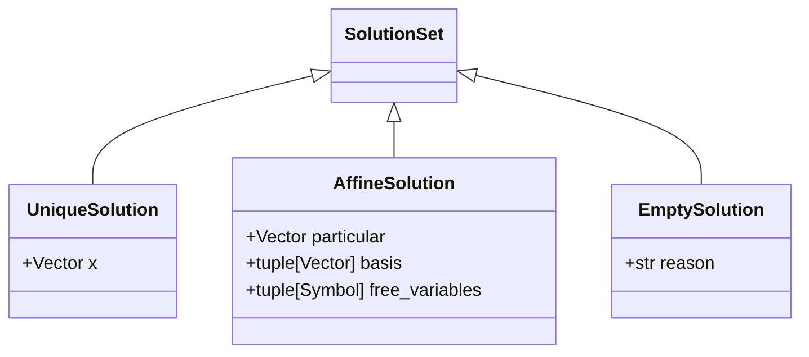

# 03. Algorithmes fondamentaux et Traçabilité hiérarchique

Le module `linalg_pedagopy.algorithms` regroupe les procédures fondamentales de l'algèbre linéaire appliquées selon l'approche de *VMLS* (Boyd & Vandenberghe) et des cours classiques de L1–L2.

Chaque procédure hérite de la classe de base [`Procedure`](src/linalg_pedagopy/algorithms/base.py#L35-L95) et s'exécute dans un contexte de traçabilité pédagogique.

---

## 1. Moteur de traçabilité contextuelle (`Tracer`)

### 1.1 Pourquoi une traçabilité hiérarchique ? (Décision D6)

L'apprentissage de l'algèbre linéaire ne consiste pas seulement à obtenir une réponse numérique brute, mais à comprendre la succession d'étapes de calcul. Cependant, un niveau d'explication unique ne convient pas à tous les publics :
- Un étudiant débutant a besoin de voir la réduction au même dénominateur lors d'une opération de ligne.
- Un étudiant avancé ne souhaite voir que la matrice résultante à chaque pivot.
- Un enseignant souhaite projeter les grandes étapes au tableau.

`linalg_pedagopy` résout ce dilemme par un **traceur arborescent contextuel** commandé par le context manager [`tracing`](src/linalg_pedagopy/trace/tracer.py#L170-L218) :

```python
from linalg_pedagopy import Matrix, Vector, GaussJordan, tracing

A = Matrix([[2, 1], [4, 3]])
b = Vector([5, 11])

# Niveau 1 : Macro-étapes (étapes de pivot)
with tracing(level=1):
    res = GaussJordan(A, b).run()
print(res.explain())

# Niveau 2 : Micro-étapes (opérations élémentaires détaillées)
with tracing(level=2):
    res = GaussJordan(A, b).run()
print(res.explain())
```

### 1.2 Les 4 niveaux de zoom didactiques

| Niveau | Nom | Description du contenu de la trace |
| :---: | :--- | :--- |
| **0** | **Résultat seul** | Aucune trace intermédiaire ; seul le résultat final est retourné. |
| **1** | **Macro-étapes** | Grandes phases : choix du pivot, passage en forme triangulaire supérieure, phase de remontée de Jordan. |
| **2** | **Micro-étapes** *(recommandé)* | Opérations élémentaires sur les lignes ($L_2 \leftarrow L_2 - 2 L_1$), calculs de projections et normalisations. |
| **3** | **Arithmétique élémentaire** | Détail arithmétique de chaque coefficient, calcul des produits scalaires terme à terme et simplification des radicaux. |

### 1.3 Nœuds de l'arbre : `Step`, `StepKind` et `Highlight`

L'arbre de trace est composé de nœuds immuables [`Step`](src/linalg_pedagopy/trace/step.py#L42-L78). Chaque étape possède :
- Un type d'action [`StepKind`](src/linalg_pedagopy/trace/step.py#L10-L28) (`ROW_SWAP`, `ROW_SCALE`, `ROW_ADD`, `PROJECTION`, `NORMALIZE`, etc.).
- Des instantanés matriciels (`snapshot`).
- Une mise en valeur graphique [`Highlight`](src/linalg_pedagopy/trace/step.py#L30-L39) spécifiant les coordonnées du pivot $(i, j)$, les lignes modifiées et la barre de séparation augmentée.

---

## 2. Élimination de Gauss-Jordan (`GaussJordan`)

La procédure [`GaussJordan`](src/linalg_pedagopy/algorithms/gauss_jordan.py#L38-L480) résout les systèmes linéaires formels $A x = b$ et calcule l'inverse de matrices carrées.

### 2.1 Signature et options

```python
GaussJordan(
    A: Matrix,
    b: Vector | Matrix | None = None,
    *,
    assumptions: Condition | None = None,
    strict: bool = True,
    compute_inverse: bool = False
)
```

- `A` : Matrice des coefficients $m \times n$.
- `b` : Vecteur ou matrice du second membre (optionnel).
- `assumptions` : Hypothèses initiales sur les paramètres de la branche.
- `strict` : Si `True`, lève une exception en cas de système incompatible ou singulier au lieu de retourner un ensemble vide.
- `compute_inverse` : Si `True`, calcule l'inverse via l'échelonnement simultané de $[A \mid I_n]$.

### 2.2 Typologie des ensembles de solutions

Le résultat renvoyé par `GaussJordan.run()` est un [`GJResult`](src/linalg_pedagopy/algorithms/gauss_jordan.py#L22-L35) dont la propriété `solution` appartient à l'une des 3 catégories de [`SolutionSet`](src/linalg_pedagopy/algorithms/base.py#L10-L32) :



1. **`UniqueSolution`** : Système de Cramer ou système rectangulaire compatible de rang plein colonne.  
   $\mathcal{S} = \{ x_0 \}$.
2. **`AffineSolution`** : Sous-déterminé ou système compatible de rang déficient.  
   $\mathcal{S} = x_p + \text{Vect}(v_1, \dots, v_k)$. L'objet fournit la solution particulière $x_p$ et une base du noyau $\{v_1, \dots, v_k\}$.
3. **`EmptySolution`** : Système incompatible (présence d'une ligne d'incompatibilité $[0 \dots 0 \mid \beta]$ avec $\beta \neq 0$).  
   $\mathcal{S} = \emptyset$.

### 2.3 Exemple avec paramètre et discussion automatique

```python
from linalg_pedagopy import Matrix, Vector, symbols, GaussJordan

m, = symbols("m")
A = Matrix([
    [1, 1, m],
    [1, m, 1],
    [m, 1, 1]
])
b = Vector([1, 1, 1])

res = GaussJordan(A, b).run()
print(res.explain())
```

Ce code produit automatiquement un `CaseSplit` distinguant :
- Le cas $m = 1$ : infinité de solutions (plan affine de dimension 2).
- Le cas $m = -2$ : système incompatible ($\emptyset$).
- Le cas $m \notin \{1, -2\}$ : solution unique $x = \left(\frac{1}{m+2}, \frac{1}{m+2}, \frac{1}{m+2}\right)$.

---

## 3. Substitutions Triangulaires

Pour les systèmes dont la matrice est déjà échelonnée, les algorithmes de substitution évitent le coût complet d'un pivot de Gauss :

- [`ForwardSubstitution`](src/linalg_pedagopy/algorithms/triangular.py#L25-L80) : Résout $L y = b$ pour une matrice triangulaire inférieure $L$ (descente).
- [`BackSubstitution`](src/linalg_pedagopy/algorithms/triangular.py#L85-L140) : Résout $U x = y$ pour une matrice triangulaire supérieure $U$ (remontée).

```python
from linalg_pedagopy import Matrix, Vector, BackSubstitution

U = Matrix([
    [2, 1, -1],
    [0, 3,  2],
    [0, 0,  4]
])
y = Vector([3, 8, 4])

res = BackSubstitution(U, y).run()
print(res.x)  # Vector([1, 2, 1])
```

---

## 4. Orthogonalisation de Gram-Schmidt (`GramSchmidt`)

La procédure [`GramSchmidt`](src/linalg_pedagopy/algorithms/gram_schmidt.py#L35-L275) transforme une famille libre de vecteurs $(a_1, \dots, a_k)$ en une famille orthogonale $(u_1, \dots, u_k)$ puis orthonormée $(q_1, \dots, q_k)$ :

$$u_k = a_k - \sum_{i=1}^{k-1} \frac{\langle a_k, u_i \rangle}{\|u_i\|^2} u_i, \quad q_k = \frac{u_k}{\|u_k\|}$$

```python
from linalg_pedagopy import Vector, GramSchmidt

a1 = Vector([1, 1, 0])
a2 = Vector([1, 0, 1])
a3 = Vector([0, 1, 1])

res = GramSchmidt([a1, a2, a3]).run()

# Vecteurs orthogonaux
for u in res.orthogonal:
    print(u)

# Vecteurs orthonormés (avec radicaux exacts)
for q in res.orthonormal:
    print(q)
```

### Détection de dépendance linéaire

Si la famille est liée, `GramSchmidt` lève une [`LinearDependenceError`](src/linalg_pedagopy/core/exceptions.py) contenant un témoin de dépendance [`DependenceWitness`](src/linalg_pedagopy/algorithms/gram_schmidt.py#L18-L32) détaillant la combinaison linéaire nulle.

---

## 5. Factorisation QR (`QR`)

La classe [`QR`](src/linalg_pedagopy/algorithms/qr.py#L30-L190) factorise une matrice $A$ de rang plein colonne sous la forme $A = Q R$, où $Q$ a des colonnes orthonormales ($Q^T Q = I$) et $R$ est triangulaire supérieure inversible.

Trois méthodes sont supportées :
1. `method="gram_schmidt"` : Gram-Schmidt classique ou modifié (forme symbolique naturelle).
2. `method="householder"` : Réflexions orthogonales de Householder (stabilité géométrique).
3. `method="givens"` : Rotations planes de Givens (idéal pour annuler des coefficients ciblés).

```python
from linalg_pedagopy import Matrix, QR

A = Matrix([
    [1, -1],
    [1,  0],
    [1,  1]
])

qr_res = QR(A, method="gram_schmidt").run()
print("Q =", qr_res.Q)
print("R =", qr_res.R)
print("Vérification Q @ R == A :", qr_res.Q @ qr_res.R == A)
```

---

## 6. Moindres Carrés Linéaires (`LeastSquares`)

La régression au sens des moindres carrés résout le problème d'optimisation :
$$\min_{x} \|A x - b\|^2$$

La classe [`LeastSquares`](src/linalg_pedagopy/algorithms/least_squares.py#L30-L150) calcule la solution exacte $\hat{x}$ via :
- La factorisation QR de $A$ : $R \hat{x} = Q^T b$.
- Les équations normales : $(A^T A) \hat{x} = A^T b$.

```python
from linalg_pedagopy import Matrix, Vector, LeastSquares

A = Matrix([
    [1, 0],
    [1, 1],
    [1, 2],
    [1, 3]
])
b = Vector([1, 2, 2, 4])

ls = LeastSquares(A, b).run()
print("x_hat =", ls.x_hat)  # Estimateur des paramètres
print("y_hat =", ls.y_hat)  # Projection y_hat = A x_hat
print("r_hat =", ls.r_hat)  # Résidu r_hat = A x_hat - b
print("Norme au carré de l'erreur :", ls.residual_norm_sq)

# Vérification pédagogique fondamentale : A^T r_hat == 0
print("Orthogonalité du résidu :", ls.verify())  # True
```
