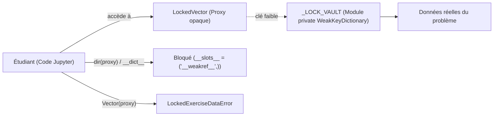

# 04. Le Tuteur Interactif VMLS (`tutor` / `tuteur`)

Le module [`linalg_pedagopy.tutor`](../src/linalg_pedagopy/tutor/__init__.py) (entièrement accessible sous l'alias francophone [`linalg_pedagopy.tuteur`](../src/linalg_pedagopy/tuteur/__init__.py)) fournit un environnement d'apprentissage autonome guidé pour les exercices du recueil officiel *Additional Exercises for VMLS*.

---

## 1. Architecture anti-triche et coffre-fort d'isolation

### 1.1 Le défi de l'introspection dans Jupyter

Dans un carnet Jupyter interactif, les étudiants disposent de l'interpréteur Python complet. Sans protection rigoureuse, ils pourraient inspecter les objets internes :
- `ex.__dict__` ou `dir(ex)` pour extraire la solution de référence.
- Instancier `Vector(ex.data.x)` pour court-circuiter le verrouillage.
- Écrire `ex.unlocked = True` ou modifier les compteurs de tentatives.

### 1.2 La solution : Coffres-forts privés `WeakKeyDictionary`

`linalg_pedagopy` isole strictement les données sensibles et les objets de l'exercice :
- Les données réelles sont stockées dans des dictionnaires à clés faibles privés au module ([`_LOCK_VAULT`](../src/linalg_pedagopy/tutor/lock.py), [`_SESSION_VAULT`](../src/linalg_pedagopy/tutor/catalog.py), [`_LAB_VAULT`](../src/linalg_pedagopy/tutor/lab.py)).
- Les objets visibles par l'étudiant ([`LockedVector`](../src/linalg_pedagopy/tutor/lock.py), [`LockedMatrix`](../src/linalg_pedagopy/tutor/lock.py), [`LockedNamespace`](../src/linalg_pedagopy/tutor/lock.py)) définissent `__slots__ = ("__weakref__",)` : ils ne possèdent aucun `__dict__` local.
- Toute tentative d'écriture (`__setattr__`) est interceptée et rejetée.
- Les constructeurs standards `Vector(...)` et `Matrix(...)` détectent la présence d'un objet verrouillé et lèvent une exception [`LockedExerciseDataError`](../src/linalg_pedagopy/core/exceptions.py).



---

## 2. Le Catalogue des 35 Fiches VMLS

Les fiches d'exercices se trouvent au format YAML dans le répertoire [`src/linalg_pedagopy/tuteur/fiches/`](../src/linalg_pedagopy/tuteur/fiches/).

### 2.1 Structure d'une fiche d'exercice

Chaque fiche contient les champs suivants (tous présents dans les 35 fiches fournies) :
- `id` : identifiant de l'exercice VMLS (ex. `'6.4'`).
- `page` : page de l'exercice dans le recueil *Additional Exercises*.
- `type` : nature de l'exercice (`modelisation`, `calcul`, `vrai_faux`, `contre_exemple`, `dimensions`…).
- `reformulation` : énoncé reformulé en français, en Markdown avec formules LaTeX.
- `donnees` : paramètres et données de l'exercice (verrouillés côté étudiant).
- `verification` : spécification du vérificateur (`type` parmi `produit_scalaire`, `matrice`, `formule`, `valeur`, `propriete`, `contre_exemple`, `labo`, `egalites`, `dimensions`, et champs propres à chaque type, comme `cible`).
- `indices` : au moins 3 paliers d'indices textuels (le palier 4 est l'exercice jumeau).
- `jumeau` : appel d'un générateur d'exercice jumeau, par exemple `generateurs.moyenne_glissante(fenetre=2, n=5)`.
- `notions` : notions mobilisées (affichées avec l'énoncé).
- `source` : référence exacte dans le recueil officiel.
- `ecart` : description des éventuelles adaptations par rapport à l'énoncé original.

Exemple (fiche `6.4.yaml`, abrégée) :

```yaml
id: '6.4'
page: 15
type: modelisation
reformulation: $p \in \mathbb{R}^6$ est une série de prix. ... Trouver la matrice $A$ telle que $d = A p$.
donnees: {n: 6, m: 3}
verification:
  type: matrice
  inconnue: p
  nom_sortie: d
  taille_entree: 6
  taille_sortie: 3
  cible: d[i] = p[i+3] - (p[i] + p[i+1] + p[i+2]) / 3
indices:
- Quelle est la taille de $d$ ? celle de $p$ ? Qu'en déduisez-vous pour $A$ ?
- ...
jumeau: generateurs.moyenne_glissante(fenetre=2, n=5)
```

### 2.2 Validation croisée d'intégrité (`validate_sheet`)

La fonction [`validate_sheet`](../src/linalg_pedagopy/tutor/catalog.py) (alias [`valider_fiche`](../src/linalg_pedagopy/tuteur/__init__.py)) contrôle automatiquement une fiche :
1. Présence des champs obligatoires (`id`, `type`, `reformulation`, `verification`, `indices`) et des champs de traçabilité (`source`, `ecart`).
2. Validité du type de vérificateur et de ses champs (par ex. `cible` pour `matrice` ou `formule`).
3. Exécution du générateur d'exercice jumeau.
4. Absence de fuite dans les indices : au moins 3 indices, aucun ne contient littéralement la cible, aucun (ni aucun littéral `Vector([...])` / `Matrix([...])` qu'il contient) n'est accepté par le vérificateur. Ces contrôles utilisent une session `persist_journal=False` pour ne pas polluer le journal de l'étudiant.
5. Contrôle croisé du vérificateur avec le solveur de référence.

Le résultat est un `ValidationReport` immuable : `valid`, `target_ok`, `twin_ok`, `hints_leak_free`, `source_ok`, `cross_check_ok`, `errors` (alias français `valide`, `cible_ok`, `jumeau_ok`, `indices_sans_fuite`, `erreurs`).

```python
from linalg_pedagopy.tutor import validate_sheet, list_exercises

# Validation d'une fiche particulière
rapport = validate_sheet("6.4")
print("Fiche valide :", rapport.valid)     # True
print(rapport.errors)                      # ()

# Validation de l'ensemble des fiches (list_exercises renvoie des identifiants)
ids = list_exercises()
print(len(ids), ids[:5])                   # 35 ['1.2', '1.3', '1.4', '2.1', '2.2']
for ex_id in ids:
    rep = validate_sheet(ex_id)
    assert rep.valid, f"Échec sur {ex_id} : {rep.errors}"
```

---

## 3. Déroulement d'une séance avec `ExerciseSession`

### 3.1 Initialisation

```python
from linalg_pedagopy.tutor import exercise

ex = exercise("6.4")          # exercise(ex_id, *, journal_path=None)
print(ex.id, ex.type, ex.page)   # 6.4 modelisation 15
```

Les données de l'exercice sont accessibles via `ex.data` (alias `ex.donnees`), un `LockedNamespace` dont les vecteurs et matrices sont verrouillés tant que l'exercice n'est pas résolu.

### 3.2 Consultation de l'énoncé (`statement`)

```python
ex.statement()          # dans JupyterLab : rendu Markdown + LaTeX
print(ex.statement())   # en console : texte Markdown brut
```

Affiche la reformulation, la référence de page dans le recueil, les notions mobilisées et la source.

### 3.3 Système d'indices gradués (`hint`)

Pour favoriser la recherche autonome, les indices sont organisés en 4 paliers ; chaque appel débloque le palier suivant (on peut aussi demander `ex.hint(2)` / `ex.indice(niveau=2)`, sans sauter de palier) :

```python
h1 = ex.hint()     # **[Niveau 1 — Orientation]** ...
print(h1)

h2 = ex.hint()     # **[Niveau 2 — Outil]** ...
print(h2)
```

| Palier | Titre affiché | Contenu (fiche 6.4) |
| :---: | :--- | :--- |
| **Niveau 1** | Orientation | *« Quelle est la taille de $d$ ? celle de $p$ ? Qu'en déduisez-vous pour $A$ ? »* |
| **Niveau 2** | Outil | *« La ligne $i$ de $A$ contient les coefficients de $d_i$ exprimé en fonction de $p_1, \dots, p_6$. »* |
| **Niveau 3** | Démarrage | *« Écrivez $d_1$ en fonction des $p_j$, puis lisez ses coefficients. »* |
| **Niveau 4** | Exercice jumeau résolu | Résolution complète d'un exercice analogue (autres dimensions ou valeurs). |

Il n'existe pas de niveau 5 « solution » en mode étudiant. Les réglages `config.hint_min_attempts` et `config.hint_min_delay_seconds` permettent d'imposer un nombre de tentatives ou un délai entre deux déblocages.

> [!IMPORTANT]
> La garantie anti-fuite est vérifiée par `validate_sheet` : aucun indice ne contient la cible littérale ni n'est accepté comme réponse par le vérificateur.

### 3.4 L'Exercice Jumeau (`twin`)

L'étudiant bloqué peut consulter un exercice analogue entièrement résolu (cela débloque aussi le palier 4). `twin()` renvoie un `TwinExercise` (`title`, `statement`, `solution_summary`, `explanation`) :

```python
jumeau = ex.twin()
print("Titre :", jumeau.title)
print("Énoncé jumeau :", jumeau.statement)
print("Solution détaillée :", jumeau.solution_summary)
```

### 3.5 Prédiction et laboratoire de contre-exemples (`predict`, `lab`)

Pour les exercices vrai/faux (vérificateur `labo`), l'étudiant doit **s'engager avant d'explorer** : il enregistre sa prédiction avec `predict`, puis seulement ouvre le laboratoire. Appeler `lab()` sans prédiction lève une `PedagopyError`.

Exemple avec l'exercice 3.3 (*$a \perp c$ et $b \perp c$ ; a-t-on (a) $a \perp b$, (b) $(a+b) \perp c$, (c) $(a-b) \perp (a+b)$ ?*) :

```python
from linalg_pedagopy import Vector

ex33 = exercise("3.3")
print(ex33.predict(a="peut être faux", b="toujours vrai", c="peut être faux"))

lab = ex33.lab()
rapport_lab = lab.test(a=Vector([1, 0, 0]), b=Vector([1, 1, 0]), c=Vector([0, 0, 1]))
print(rapport_lab.hypotheses_satisfied)   # True  (a ⊥ c et b ⊥ c)
print(dict(rapport_lab.results_by_part))  # {'a': False, 'b': True, 'c': False}
print(rapport_lab.found_counterexample)   # True
print(rapport_lab.message)
```

`lab.test(**instances)` renvoie un `LabReport` (`hypotheses_satisfied`, `results_by_part`, `found_counterexample`, `message`). Le laboratoire rappelle qu'un essai concluant ne démontre pas une affirmation « toujours vraie ».

### 3.6 Vérification de la solution (`verify`)

L'étudiant soumet sa réponse finale ; `verify` renvoie un `VerificationResult` immuable (`valid`, `diagnostic`, `simplicity_note` ; alias `valide`, `note_simplicite`) :

```python
from linalg_pedagopy import Matrix

reponse = Matrix.zeros(3, 6)
rapport = ex.verify(reponse)
print("Succès :", rapport.valid)   # False
print(rapport.diagnostic)
# Taille correcte (3 x 6).
# Votre ligne 1 calcule d_1 = 0.
# Relisez la définition de d_1 : quel est le prix « du jour » pour i = 1 ?
```

Le diagnostic dépend du type de vérificateur : taille incorrecte, ligne ou coefficient erroné, erreur typique (signe, décalage d'indice), propriété non satisfaite, etc. Il ne révèle jamais la réponse attendue. Une réponse correcte déverrouille les données de l'exercice.

---

## 4. Journal d'apprentissage persistant et atomique (`ExerciseJournal`)

Toutes les interactions de l'étudiant (tentatives, indices, jumeau, prédictions, essais au laboratoire, temps passé) sont journalisées dans le fichier `config.journal_path` (par défaut `.linalg_pedagopy_journal.json` dans le répertoire courant, ou le chemin passé à `exercise(..., journal_path=...)`) :
- **Persistance de session** : au rechargement d'un exercice (après redémarrage du noyau par exemple), le journal existant est relu : indices déjà débloqués, nombre de tentatives et temps écoulé sont repris.
- **Écriture atomique** : les données sont d'abord écrites dans un fichier temporaire `<nom>.<pid>.tmp` du même dossier, qui remplace ensuite le fichier de destination (`os.replace`), évitant toute corruption en cas d'interruption.

Le bilan est accessible par `ex.summary()` (alias `ex.bilan()`) :

```text
=== Bilan de l'exercice 6.4 ===
- Statut               : En cours
- Tentatives soumises  : 1
- Indices consultés    : 1, 2, 3, 4
- Exercice jumeau lu   : oui
- Essais au labo       : 0
- Temps passé          : 0.3 s
```

---

## 5. Interface interactive JupyterLab (`panel`)

Dans JupyterLab, avec `ipywidgets` installé (extra `tuteur`), l'étudiant peut afficher un petit panneau graphique :

```python
ex.panel()
```

Ce panneau affiche :
- un en-tête avec le numéro et l'énoncé de l'exercice ;
- trois boutons : **Indice suivant (1–4)**, **Exercice jumeau** et **Bilan** ;
- une zone de texte où s'affiche la réponse du tuteur.

La soumission d'une réponse se fait dans une cellule avec `ex.verify(...)`. Sans `ipywidgets`, `panel()` renvoie un objet de repli textuel (`PanelFallback`).

---

## 6. Mode Enseignant

L'enseignant peut basculer le tuteur en mode enseignant (`"teacher"` / `"enseignant"`, retour avec `"student"` / `"etudiant"`) :

```python
from linalg_pedagopy import tutor

tutor.mode("teacher")            # équivalent : config.tutor_mode = "teacher"

ex = exercise("6.4")
fiche_prof = ex.teacher_sheet()  # TeacherSheet (dict) ; PermissionError en mode étudiant
print(list(fiche_prof.keys()))
print(fiche_prof["verification"]["cible"])
fiche_prof                       # dans JupyterLab : rendu Markdown complet de la fiche

tutor.mode("student")
```

En mode enseignant, les données de l'exercice sont également déverrouillées.
