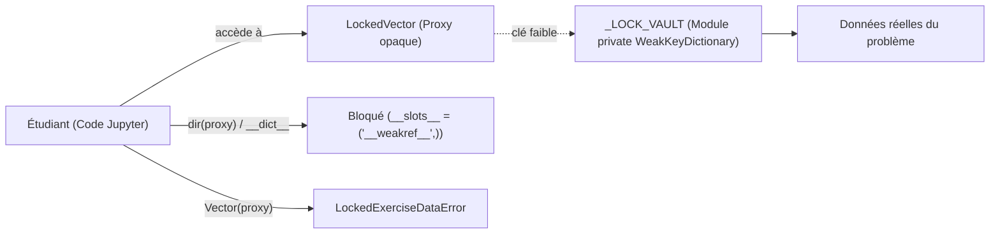

# 04. Le Tuteur Interactif VMLS (`tutor` / `tuteur`)

Le module [`linalg_pedagopy.tutor`](src/linalg_pedagopy/tutor/__init__.py) (entièrement accessible sous l'alias francophone [`linalg_pedagopy.tuteur`](src/linalg_pedagopy/tuteur/__init__.py)) fournit un environnement d'apprentissage autonome guidé pour les exercices du recueil officiel *Additional Exercises for VMLS*.

---

## 1. Architecture anti-triche et coffre-fort d'isolation

### 1.1 Le défi de l'introspection dans Jupyter

Dans un carnet Jupyter interactif, les étudiants disposent de l'interpréteur Python complet. Sans protection rigoureuse, ils pourraient inspecter les objets internes :
- `ex.__dict__` ou `dir(ex)` pour extraire la solution de référence.
- Instancier `Vector(ex.data.x)` pour court-circuiter le verrouillage.
- Remplacer `ex.is_solved = True` ou modifier les compteurs de tentatives.

### 1.2 La solution : Coffres-forts privés `WeakKeyDictionary`

`linalg_pedagopy` isole strictement les données sensibles et les objets de l'exercice :
- Les données réelles sont stockées dans des dictionnaires à clés faibles privés au module ([`_LOCK_VAULT`](src/linalg_pedagopy/tutor/lock.py#L22), [`_SESSION_VAULT`](src/linalg_pedagopy/tutor/catalog.py#L28), [`_LAB_VAULT`](src/linalg_pedagopy/tutor/lab.py#L20)).
- Les objets visibles par l'étudiant ([`LockedVector`](src/linalg_pedagopy/tutor/lock.py#L110-L195), [`LockedMatrix`](src/linalg_pedagopy/tutor/lock.py#L198-L300), [`LockedNamespace`](src/linalg_pedagopy/tutor/lock.py#L45-L95)) définissent `__slots__ = ("__weakref__",)` : ils ne possèdent aucun `__dict__` local.
- Toute tentative d'écriture (`__setattr__`) est interceptée et rejetée.
- Les constructeurs standards `Vector(...)` et `Matrix(...)` détectent la présence d'un objet verrouillé et lèvent une exception [`LockedExerciseDataError`](src/linalg_pedagopy/core/exceptions.py).



---

## 2. Le Catalogue des 35 Fiches VMLS

Les fiches d'exercices se trouvent au format YAML dans le répertoire [`src/linalg_pedagopy/tuteur/fiches/`](src/linalg_pedagopy/tuteur/fiches/).

### 2.1 Structure d'une fiche d'exercice

Chaque fiche contient :
- `id` : Identifiant de l'exercice VMLS (ex: `"6.4"`).
- `titre` : Intitulé pédagogique.
- `section_vmls` : Chapitre de référence dans *VMLS*.
- `difficulte` : Niveau de 1 à 3.
- `source` : Référence exacte dans le recueil officiel (ex: `"VMLS Additional Exercises, Exercise 6.4"`).
- `ecart` : Description explicite des éventuelles adaptations didactiques (généralisation formelle, fractions exactes).
- `enonce` : Texte de l'énoncé en Markdown avec formules LaTeX.
- `donnees` : Paramètres et matrices de départ.
- `indices` : 4 paliers d'indices progressifs sans fuite de réponse.
- `jumeau` : Énoncé et solution détaillée d'un problème isomorphe.
- `verification` : Spécification formelle pour le vérificateur de solution.

### 2.2 Validation croisée d'intégrité (`validate_sheet`)

La fonction [`validate_sheet`](src/linalg_pedagopy/tutor/catalog.py#L416-L497) (alias [`valider_fiche`](src/linalg_pedagopy/tuteur/__init__.py)) contrôle automatiquement la validité d'une fiche :
1. Elle charge la fiche en mode isolé (`persist_journal=False` pour ne pas polluer l'historique étudiant).
2. Elle résout formellement le problème avec le solveur de référence.
3. Elle soumet la solution au vérificateur (`verify`) et s'assure qu'elle est validée à 100 %.
4. Elle teste des réponses triviales erronées ($0$, identité) pour s'assurer que le vérificateur ne valide pas aveuglément les entrées fausses.

```python
from linalg_pedagopy.tutor import validate_sheet

# Validation d'une fiche particulière
rapport = validate_sheet("6.4")
print("Fiche valide :", rapport.is_valid)

# Validation de l'ensemble des 35 fiches
from linalg_pedagopy.tutor import list_exercises
for ex_meta in list_exercises():
    rep = validate_sheet(ex_meta["id"])
    assert rep.is_valid, f"Échec sur {ex_meta['id']}"
```

---

## 3. Déroulement d'une séance avec `ExerciseSession`

### 3.1 Initialisation

```python
from linalg_pedagopy.tutor import exercise

ex = exercise("6.4")
```

### 3.2 Consultation de l'énoncé (`statement`)

```python
print(ex.statement())
```

Affiche l'énoncé complet, les données vectorielles et matricielles associées, ainsi que les consignes de format de réponse.

### 3.3 Système d'indices gradués (`hint`)

Pour favoriser la recherche autonome sans court-circuiter l'effort de réflexion, les indices sont organisés en 4 paliers :

```python
# Déblocage de l'indice 1
h1 = ex.hint()
print(h1)

# Déblocage de l'indice 2
h2 = ex.hint()
print(h2)
```

| Palier | Type d'aide | Exemple |
| :---: | :--- | :--- |
| **Niveau 1** | Rappel de définition / concept | *"Rappelez-vous qu'une projection orthogonale $p$ sur $\text{Vect}(a)$ satisfait $a^T (x - p) = 0$."* |
| **Niveau 2** | Stratégie méthodique | *"Exprimez $p$ sous la forme $\alpha a$ puis déterminez le scalaire $\alpha$ par produit scalaire."* |
| **Niveau 3** | Formule générale ou étape clé | *"La formule générale est $p = \frac{\langle a, x \rangle}{\|a\|^2} a$."* |
| **Niveau 4** | Exemple jumeau résolu | *Renvoie vers l'étude de l'exercice jumeau avec valeurs numériques différentes.* |

> [!IMPORTANT]
> Les indices ne contiennent **aucune valeur numérique** correspondant à la solution de l'exercice en cours (*garantie anti-fuite*).

### 3.4 L'Exercice Jumeau (`twin`)

L'étudiant bloqué peut consulter à tout moment un exercice isomorphe entièrement résolu et commenté :

```python
jumeau = ex.twin()
print("Énoncé jumeau :", jumeau.statement)
print("Solution détaillée :", jumeau.solution_summary)
```

### 3.5 Prédiction d'étapes (`predict`)

L'étudiant peut soumettre une étape intermédiaire pour s'assurer qu'il est sur la bonne voie avant de finaliser son calcul :

```python
res = ex.predict(alpha="2/3")
print(res)
```

### 3.6 Le Laboratoire de contre-exemples (`lab`)

Lorsqu'un exercice demande de démontrer si une propriété est vraie ou fausse (par exemple : *"Si $A^T A = I$, alors $A A^T = I$ ? "*), l'étudiant peut tester sa conjecture dans le laboratoire :

```python
lab = ex.lab()
# Teste si la propriété est vraie pour des matrices aléatoires non carrées
rapport_lab = lab.test_property(lambda A: (A.T @ A).is_identity() and (A @ A.T).is_identity())
print(rapport_lab)
```

### 3.7 Vérification formelle de la solution (`verify`)

L'étudiant soumet sa proposition de réponse finale :

```python
from linalg_pedagopy import Vector

reponse = Vector([2, 1, 0])
rapport = ex.verify(reponse)
print(rapport.message)
print("Succès :", rapport.is_valid)
```

Si la réponse est incorrecte, le vérificateur analyse la cause de l'erreur :
- Mauvaise dimension.
- Erreur de signe ou d'inversion d'indices.
- Non-orthogonalité du résidu.
- Non-appartenance au sous-espace demandé.

---

## 4. Journal d'apprentissage persistant et atomique (`ExerciseJournal`)

Toutes les interactions de l'étudiant sont automatiquement journalisées dans `.linalg_pedagopy_journal.json` :
- **Persistance de session** : Si le noyau Python ou Jupyter est redémarré, le rechargement de l'exercice reprend l'historique exact (indices déjà dévoilés, nombre de tentatives, temps de recherche écoulé).
- **Écriture atomique** : Les données sont écrites dans un fichier temporaire `.linalg_pedagopy_journal.json.tmp` avant d'écraser le fichier de destination par remplacement atomique, évitant toute corruption en cas d'interruption.

---

## 5. Interface interactive JupyterLab (`panel`)

Dans un carnet Jupyter interactif, l'étudiant peut invoquer le panneau graphique basé sur `ipywidgets` :

```python
ex.panel()
```

Ce panneau affiche :
- Un onglet avec l'énoncé formaté en LaTeX.
- Des boutons d'indices se débloquant au clic.
- Une zone de saisie pour soumettre des vecteurs ou matrices.
- Un retour visuel immédiat avec message formaté en vert ou rouge.

---

## 6. Mode Enseignant

L'enseignant peut basculer l'environnement en mode superviseur :

```python
from linalg_pedagopy.config import config

config.tutor_mode = "teacher"

# Accès à la fiche complète du professeur
ex = exercise("6.4")
fiche_prof = ex.teacher_sheet()
print(fiche_prof.full_solution)
print(fiche_prof.pedagogical_remarks)
```
