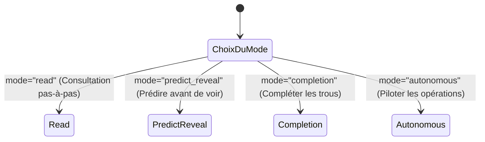

# 05. Exercices pédagogiques et Sessions interactives

Le module `linalg_pedagopy.exercises` propose des outils de génération procédurale d'exercices d'algèbre linéaire à coefficients « propres » (entiers ou rationnels simples) ainsi qu'un moteur de sessions interactives pas-à-pas.

---

## 1. Générateurs de matrices et problèmes « propres » (`generators`)

> Pour les matrices structurées classiques (différences, sommes cumulées, moyenne glissante, Vandermonde, convolution, sélection, renversement), voir la [section 5 du guide 02](02_vectors_and_matrices.md).

### 1.1 Le problème des fractions géantes

Dans un cours d'algèbre linéaire, générer des matrices avec des entiers aléatoires produit presque systématiquement, dès la 3e étape du pivot de Gauss ou de Gram-Schmidt, des fractions avec des numérateurs et dénominateurs à 6 ou 10 chiffres (par exemple $x = \frac{138547}{294821}$).

Cette complexité arithmétique parasite masque la compréhension des concepts géométriques fondamentaux. `linalg_pedagopy` résout ce problème grâce à des générateurs à **résultats propres garantis**.

### 1.2 Générateurs à résultats propres

Le module [`generators.py`](../src/linalg_pedagopy/exercises/generators.py) fournit des fonctions de génération reproductibles (paramètre `seed`) dont les résultats sont garantis « propres » :

| Fonction | Description mathématique | Valeur renvoyée |
| :--- | :--- | :--- |
| `generate_unimodular_matrix(n=3, *, seed=None, difficulty=1)` | Produit d'opérations élémentaires entières. | Matrice entière de déterminant $\pm 1$, d'inverse entière. |
| `generate_integer_rref_matrix(m=3, n=4, rank=2, *, seed=None, difficulty=1)` | Matrice entière $m \times n$ de rang prescrit. | Couple `(A, R)` avec `R = rref(A)` à coefficients entiers. |
| `generate_rational_qr_matrix(n=3, *, seed=None, difficulty=1)` | Matrice construite à partir d'une orthogonale de Cayley rationnelle. | Triplet `(A, Q, R)` rationnel exact, sans radicaux. |
| `generate_clean_least_squares(m=4, n=2, *, seed=None, difficulty=1)` | Problème surdéterminé $\min \|A x - b\|^2$ ($m > n$). | Quadruplet `(A, b, x_hat, r_hat)` avec `x_hat` entier et $A^T \hat r = 0$. |
| `generate_parametric_system(n=3, *, param_name="a", critical_value=1, seed=None, difficulty=1)` | Système $A(a) x = b$ dont le déterminant s'annule en une valeur critique. | Quadruplet `(A, b, a, a_crit)`. |
| `cayley_orthogonal(S)` | Transformée de Cayley $Q = (I - S)(I + S)^{-1}$ d'une matrice antisymétrique $S$. | Matrice orthogonale exacte à coefficients rationnels. |

Exemple :

```python
from linalg_pedagopy import LeastSquares, Matrix
from linalg_pedagopy.exercises import (
    generate_unimodular_matrix,
    generate_integer_rref_matrix,
    generate_clean_least_squares,
    generate_parametric_system,
    cayley_orthogonal,
)

# Matrice entière d'ordre 3 d'inverse entière
U = generate_unimodular_matrix(3, seed=42)
print("U =\n", U)
print("U^-1 =\n", U.inv())

# Matrice de rang 2 dont la RREF est entière
A, R = generate_integer_rref_matrix(3, 4, 2, seed=1)
print(A.rref() == R)                    # True

# Problème de moindres carrés propre
A_ls, b_ls, x_attendu, r_attendu = generate_clean_least_squares(4, 2, seed=123)
res = LeastSquares(A_ls, b_ls).run()
print("x_hat =", res.x_hat, "attendu :", x_attendu)   # coordonnées entières

# Système paramétré et valeur critique
A_p, b_p, a, a_crit = generate_parametric_system(3, seed=7)
print(a, a_crit)                        # a 1

# Orthogonale de Cayley
Q = cayley_orthogonal(Matrix([[0, 1], [-1, 0]]))
print(Q.has_orthonormal_columns())      # True
```

### 1.3 Générateurs d'exercices jumeaux (`generators` / `generateurs`)

L'espace de noms `generators` (alias `generateurs`) regroupe les générateurs d'**exercices jumeaux résolus** appelés par les fiches du tuteur (champ `jumeau`). Chacun renvoie un `TwinExercise` (`title`, `statement`, `solution_summary`, `explanation`) :

| Nom anglais | Alias français |
| :--- | :--- |
| `moving_average(window=2, n=5)` | `moyenne_glissante(fenetre=2, n=5)` |
| `inner_product_selection(n=5, indices=(1, 4))` | `produit_scalaire_selection(...)` |
| `vector_statistics(values=(2, -1, 5, 2))` | `statistiques_vecteur(...)` |
| `orthogonal_combination(c1=2, c2=-3)` | `combinaison_orthogonale(...)` |
| `expression_dimensions()` | `dimensions_expressions()` |
| `counterexample_guide(famille=...)` | `contre_exemple_guide(...)` |
| `polynomial_convolution(a_vals=(1, 2), b_vals=(3, -1, 1))` | `convolution_polynomes(...)` |
| `right_inverse_example()` | `inverse_droite_exemple()` |
| `gram_schmidt_example()` | `gram_schmidt_exemple()` |
| `least_squares_example()` | `moindres_carres_exemple()` |
| `kkt_minimum_norm()` | `kkt_norme_minimale()` |
| `matrix_from_action()` | `matrice_par_effet()` |
| `polynomial_evaluation()` | `evaluation_polynome()` |
| `matrix_power()` | `puissance_matrice()` |
| `adjacency_matrix()` | `matrice_adjacence()` |
| `diagonal_scaling()` | `mise_echelle_diagonale()` |
| `product_inverse()` | `inverse_produit()` |
| `system_solving()` | `resolution_systeme()` |
| `block_product()` | `identite_blocs()` |
| `triangle_inequality()` | `inegalite_triangulaire()` |

Chaque fiche du tuteur appelle un générateur adapté à son sujet : la fiche « Un réseau d'amitié » propose ainsi, au palier 4, la matrice d'adjacence d'un réseau de trois personnes, et la fiche « Inverse d'un carré » l'inverse d'un produit sur un autre exemple.

```python
from linalg_pedagopy import generators

tw = generators.moving_average(window=3, n=6)
print(tw.title)          # Écart à la moyenne glissante (fenêtre $k=3$, $n=6$)
print(tw.statement)
```

---

## 2. Sessions interactives pas-à-pas (`InteractiveSession`)

La classe [`InteractiveSession`](../src/linalg_pedagopy/exercises/interactive.py) (`InteractiveSession(procedure, *, mode="autonomous", mask_ratio=0.5)`, ou `procedure.interactive(mode=...)`) transforme une procédure en exercice d'apprentissage actif.

### 2.1 Les 4 modes interactifs



1. **Mode `"read"`** : l'étudiant avance dans les étapes élémentaires de la procédure avec `reveal()`.
2. **Mode `"predict_reveal"`** : `reveal()` refuse d'afficher l'étape suivante tant qu'une prédiction n'a pas été enregistrée avec `predict("...")`.
3. **Mode `"completion"`** : `completion_view()` renvoie la liste des étapes dont les dernières (proportion `mask_ratio`) sont masquées (`"??? (étape à compléter)"`).
4. **Mode `"autonomous"`** *(Gauss-Jordan uniquement)* : l'étudiant applique lui-même les opérations élémentaires avec `propose("L2 <- L2 - 3*L1")` ; `hint()` suggère l'opération utile suivante et `is_complete()` indique si la forme échelonnée réduite est atteinte.

### 2.2 Exemple de session autonome sur Gauss-Jordan

Les opérations s'écrivent sous forme de texte : échange `"L1 <-> L2"`, dilatation `"L2 <- (1/2)*L2"`, transvection `"L2 <- L2 - 3*L1"` (préfixe `only_A:` ou `propose(..., only_lhs=True)` pour n'agir que sur la partie gauche, ce qui est signalé comme une erreur).

```python
from linalg_pedagopy import Matrix, Vector, GaussJordan
from linalg_pedagopy.exercises import InteractiveSession

A = Matrix([[1, 2], [3, 8]])
b = Vector([5, 17])

session = InteractiveSession(GaussJordan(A, b), mode="autonomous")
print(session.hint())
# Suggestion : annulez le coefficient (2,1) = 3 à l'aide de la ligne pivot L1.

feedback = session.propose("L2 <- L2 - 3*L1")
print(feedback.status, "|", feedback.message)
# valid_useful | Valide. Le coefficient (2,1) est maintenant nul : progression vers la forme échelonnée.

session.propose("L2 <- (1/2)*L2")
session.propose("L1 <- L1 - 2*L2")
print(session.current_matrix.entries_grid)   # ((1, 0, 3), (0, 1, 1))
print(session.is_complete())                 # True
```

Chaque proposition renvoie un `OperationFeedback` (`status` parmi `"invalid"`, `"valid_no_progress"`, `"valid_useful"`, `message`, `new_matrix`, `error_code`, propriétés `is_valid` et `is_useful`). Une opération valide est appliquée à `session.current_matrix`, même si elle ne fait pas progresser le calcul.

### 2.3 Exemple en mode prédire-puis-révéler

```python
s = InteractiveSession(GaussJordan(A, b), mode="predict_reveal")
print(s.reveal())   # Veuillez d'abord enregistrer votre prédiction avec predict(...) ...
s.predict("L2 <- L2 - 3 L1")
print(s.reveal())   # On annule le coefficient (2,1) : L2 ← L2 − 3·L1.
```

---

## 3. Analyseur d'erreurs et rétroactions pédagogiques

Le vérificateur [`check_row_operation`](../src/linalg_pedagopy/exercises/checkers.py) (`check_row_operation(aug_matrix, operation, *, num_lhs_cols=None, only_lhs=False)`), utilisé par `propose`, ne se contente pas d'un refus brut : il identifie la cause de l'erreur (champ `error_code`). Exemples sur la matrice augmentée $[A \mid b]$ ci-dessus :

| Erreur étudiante type | Opération proposée | `status` / `error_code` | Rétroaction fournie |
| :--- | :--- | :--- | :--- |
| **Erreur de signe** | `L2 <- L2 + 3*L1` | `valid_no_progress` / `sign_error` | *« Erreur de signe dans le coefficient de transvection : le coefficient (2,1) vaut maintenant 6 et n'est pas annulé (coefficient attendu : -3). »* |
| **Dilatation par zéro** | `L2 <- 0*L2` | `invalid` / `zero_scaling` | *« Invalide : une dilatation par 0 n'est pas une opération élémentaire (perte d'information) ; l'opération n'est pas inversible : le système change. »* |
| **Écrasement d'une ligne** | `L1 <- L2` | `invalid` / `row_overwrite` | *« Invalide : L1 est remplacée par une expression qui ne la contient pas (L2). L'ancienne ligne L1 est perdue : l'opération n'est pas inversible et le système change. Pour échanger deux lignes, écrivez 'L1 <-> L2' ; pour une transvection, conservez L1 : 'L1 <- L1 + λ*L2'. »* |
| **Opération non linéaire** | `L2 <- L2**2` | `invalid` / `nonlinear_row_op` | *« Invalide : l'expression n'est pas une opération linéaire sur les lignes. »* |
| **Oubli du second membre** | `only_A: L1 <-> L2` | `invalid` / `only_lhs` | *« Invalide : opération appliquée à A mais pas au second membre. Le système obtenu n'est plus équivalent. »* |
| **Syntaxe non reconnue** | `échanger 1 et 2` | `invalid` / `syntax_error` | *« Syntaxe d'opération non reconnue : … Exemples attendus : 'L2 <- L2 - 3*L1', 'L1 <-> L2', 'L2 <- (1/2)*L2'. »* |

Le vérificateur analogue [`check_gram_schmidt_step`](../src/linalg_pedagopy/exercises/checkers.py) contrôle une étape d'orthogonalisation de Gram-Schmidt proposée par l'étudiant.
