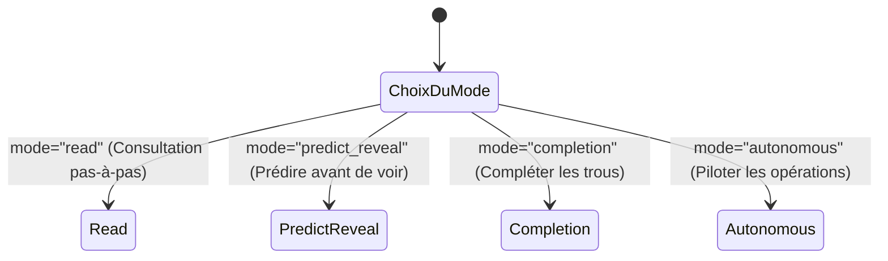

# 05. Exercices pédagogiques et Sessions interactives

Le module `linalg_pedagopy.exercises` propose des outils de génération procédurale d'exercices d'algèbre linéaire à coefficients « propres » (entiers ou rationnels simples) ainsi qu'un moteur de sessions interactives pas-à-pas.

---

## 1. Générateurs de matrices et problèmes « propres » (`generators`)

### 1.1 Le problème des fractions géantes

Dans un cours d'algèbre linéaire, générer des matrices avec des entiers aléatoires produit presque systématiquement, dès la 3e étape du pivot de Gauss ou de Gram-Schmidt, des fractions avec des numérateurs et dénominateurs à 6 ou 10 chiffres (par exemple $x = \frac{138547}{294821}$).

Cette complexité arithmétique parasite masque la compréhension des concepts géométriques fondamentaux. `linalg_pedagopy` résout ce problème grâce à des générateurs à **résultats propres garantis**.

### 1.2 Matrices structurelles de VMLS

Le sous-module [`generators`](src/linalg_pedagopy/exercises/generators.py) fournit les matrices remarquables étudiées dans *VMLS* :

```python
from linalg_pedagopy.exercises import generators

# Matrice de différences D d'ordre 4 (D x = [x₂-x₁, x₃-x₂, x₄-x₃])
D = generators.difference_matrix(4)
print(D)

# Matrice de somme cumulée S d'ordre 4 (S = D⁻¹)
S = generators.running_sum_matrix(4)
print(S)

# Matrice de moyenne mobile (Moving average) sur n=5 avec fenêtre k=3
A_ma = generators.moving_average(5, 3)
print(A_ma)

# Matrice de Vandermonde associée aux points x = [0, 1, 2] de degré 2
V = generators.vandermonde([0, 1, 2], degree=2)
print(V)

# Matrice de Gram G = A^T A
G = generators.gram_matrix(V)
print(G)
```

### 1.3 Générateurs aléatoires reproductibles à solutions élégantes

Tous les générateurs acceptent un paramètre `seed` pour assurer la reproductibilité stricte en examen ou devoir :

| Fonction | Description mathématique | Résultat garanti |
| :--- | :--- | :--- |
| `generate_unimodular_matrix(n, seed, difficulty)` | Produit d'opérations élémentaires entières unipotentes. | Matrice entière inversible d'inverse entière ($\det = \pm 1$). |
| `cayley_orthogonal(S)` | Transformée de Cayley $Q = (I - S)(I + S)^{-1}$ appliquée à une matrice antisymétrique $S$. | Matrice orthogonale exacte à coefficients rationnels. |
| `generate_rational_qr_matrix(m, n, seed)` | Synthèse d'une matrice $A$ via une base orthogonale rationnelle. | Factorisation $A = QR$ sans radicaux irrationnels. |
| `generate_integer_rref_matrix(m, n, rank, seed)` | Matrice entière de taille $m \times n$ et de rang prescrit $r$. | Forme échelonnée réduite (RREF) et pivots strictement entiers. |
| `generate_parametric_system(n, seed)` | Système linéaire $A(a) x = b(a)$ dépendant d'un paramètre $a$. | Valeurs critiques d'incompatibilité ou de rang déficient simples ($a \in \{0, \pm 1, \pm 2\}$). |
| `generate_clean_least_squares(m, n, seed)` | Problème de régression surdéterminé $\min \|A x - b\|^2$. | Estimateur $\hat{x}$ et résidu $\hat{r}$ à coordonnées rationnelles simples. |

Exemple :

```python
from linalg_pedagopy.exercises import (
    generate_unimodular_matrix,
    generate_clean_least_squares,
    generate_parametric_system
)

# Matrice entière d'ordre 3 d'inverse entière
U = generate_unimodular_matrix(3, seed=42)
print("U =\n", U)
print("U^-1 =\n", U.inv())

# Problème de moindres carrés propre
A_ls, b_ls = generate_clean_least_squares(4, 2, seed=123)
from linalg_pedagopy import LeastSquares
res = LeastSquares(A_ls, b_ls).run()
print("x_hat =", res.x_hat)  # Fractions simples (ex: 1/2, -1)
```

---

## 2. Sessions interactives pas-à-pas (`InteractiveSession`)

La classe [`InteractiveSession`](src/linalg_pedagopy/exercises/interactive.py#L19-L180) transforme toute procédure algorithmique en un exercice d'apprentissage actif pour l'étudiant.

### 2.1 Les 4 modes interactifs



1. **Mode `"read"`** : L'étudiant avance pas à pas dans l'arbre d'exécution en appuyant sur « suivant ».
2. **Mode `"predict_reveal"`** : L'étudiant doit formuler une prédiction de l'opération ou du coefficient suivant avant que le résultat ne soit affiché.
3. **Mode `"completion"`** : Une fraction de la matrice ou des opérations est masquée (`mask_ratio=0.5`). L'étudiant doit saisir les coefficients manquants.
4. **Mode `"autonomous"`** : L'étudiant applique lui-même les opérations élémentaires sur les lignes ou les vecteurs jusqu'à l'obtention de la solution.

### 2.2 Exemple de session autonome sur Gauss-Jordan

```python
from linalg_pedagopy import Matrix, Vector, GaussJordan
from linalg_pedagopy.exercises import InteractiveSession

A = Matrix([[1, 2], [3, 8]])
b = Vector([5, 17])

proc = GaussJordan(A, b)
session = InteractiveSession(proc, mode="autonomous")

# L'étudiant propose une opération élémentaire de ligne
# L2 <- L2 - 3 * L1
feedback = session.apply_row_operation(target_row=1, source_row=0, factor=-3)
print(feedback.message)
print("Matrice courante :\n", session.current_matrix)

# Normalisation du pivot : L2 <- 1/2 * L2
feedback2 = session.scale_row(target_row=1, factor="1/2")
print("Matrice courante :\n", session.current_matrix)
```

---

## 3. Analyseur d'erreurs et rétroactions pédagogiques (Annexe C)

Lorsqu'un étudiant propose une opération incorrecte dans une session autonome, le vérificateur [`check_row_operation`](src/linalg_pedagopy/exercises/checkers.py) ne se contente pas d'un refus brut : il analyse la cause de l'erreur parmi le catalogue didactique :

| Erreur étudiante type | Détection automatique | Rétroaction fournie |
| :--- | :--- | :--- |
| **Multiplication par zéro** | Facteur scalaire nul $\alpha = 0$ sur une ligne. | *"Opération interdite : multiplier une ligne par 0 détruit l'information du système."* |
| **Écrasement d'une ligne pivot** | Remplacement de la ligne pivot courante par une autre ligne. | *"Attention : vous perdez la forme échelonnée déjà construite."* |
| **Pivot nul non échangé** | Choix d'un coefficient nul comme pivot sans permutation préalable. | *"Le coefficient en position pivot est nul. Vous devez d'abord permuter avec une ligne inférieure."* |
| **Erreur de signe** | Utilisation de $+k$ au lieu de $-k$ pour éliminer un terme. | *"Le coefficient ne s'est pas annulé. Vérifiez le signe du multiplicateur."* |
| **Fausse linéarité** | Opération non linéaire (ex: $L_1 \leftarrow L_1^2$). | *"Les opérations autorisées sont strictement affines : échange, dilatation non nulle, transvection."* |
