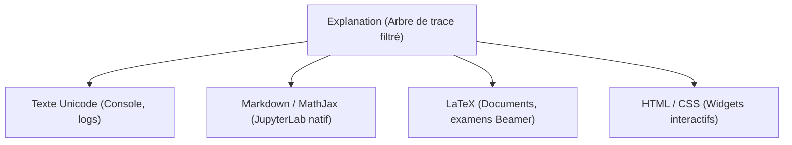

# 06. Rendu, Visualisation et Comparaison Numérique

Le package `linalg_pedagopy` offre des moteurs d'affichage polyvalents, un module graphique géométrique basé sur Matplotlib, ainsi qu'un banc de comparaison formel/numérique pour illustrer les limites du calcul flottant.

---

## 1. Moteurs de rendu multi-formats (`Explanation`)

Toutes les procédures algorithmiques renvoient un résultat muni d'une méthode [`explain(level=...)`](src/linalg_pedagopy/algorithms/base.py) produisant une instance immuable d'[`Explanation`](src/linalg_pedagopy/render/explanation.py).



### 1.1 Formats de sortie disponibles

```python
from linalg_pedagopy import Matrix, Vector, GaussJordan

A = Matrix([[1, 2], [3, 4]])
b = Vector([5, 11])
res = GaussJordan(A, b).run()
exp = res.explain(level=2)

# 1. Rendu console Unicode enrichi
print(exp.to_text())

# 2. Rendu LaTeX complet pour documents et polycopiés
print(exp.to_latex())

# 3. Rendu Markdown avec formules mathématiques
print(exp.to_markdown())

# 4. Rendu HTML avec classes CSS
html_code = exp.to_html()
```

Dans un environnement JupyterLab ou Jupyter Notebook, l'objet `Explanation` implémente `_repr_markdown_()` : il s'affiche automatiquement avec un rendu typographique soigné grâce au moteur KaTeX/MathJax sans qu'aucun appel à `print()` ne soit nécessaire.

### 1.2 Localisation et multilinguisme (`locales`)

Tous les messages explicatifs et libellés d'étapes proviennent de dictionnaires YAML situés dans [`src/linalg_pedagopy/render/locales/`](src/linalg_pedagopy/render/locales/) (`fr.yaml` et `en.yaml`).

La langue s'ajuste globalement ou localement :

```python
from linalg_pedagopy.config import config, using_config

# Basculement global en anglais
config.locale = "en"

# Basculement temporaire en français
with using_config(locale="fr"):
    print(res.explain())
```

---

## 2. Visualisation géométrique 2D et 3D (`linalg_pedagopy.plot`)

Le sous-module [`linalg_pedagopy.plot`](src/linalg_pedagopy/plot/geometry.py) fournit des représentations géométriques directes des concepts vectoriels de VMLS via Matplotlib.

> [!NOTE]
> Ce module nécessite l'installation de la dépendance facultative : `pip install linalg_pedagopy[plot]`.

### 2.1 Fonctions graphiques disponibles

| Fonction | Description géométrique | Dimension |
| :--- | :--- | :---: |
| `plot_linear_combination_2d(u, v, c1, c2)` | Règle du parallélogramme pour la combinaison linéaire $w = c_1 u + c_2 v$. | $\mathbb{R}^2$ |
| `plot_orthogonal_projection_2d(a, q)` | Projection orthogonale de $a$ sur la droite $\text{Vect}(q)$ et vecteur résidu. | $\mathbb{R}^2$ |
| `plot_gram_schmidt_2d(vectors)` | Tracé simultané des vecteurs initiaux et de la base orthonormée $(q_1, q_2)$. | $\mathbb{R}^2$ |
| `plot_least_squares_fit(x_data, y_data, ls_result)` | Nuage de points, droite/modèle ajusté $\hat{y} = A \hat{x}$ et résidus verticaux. | Plan |
| `plot_least_squares_geometry_3d(ls_result)` | Vue spatiale du vecteur $b$, de sa projection orthogonale $\hat{y}$ sur $\text{Col}(A)$ et du vecteur résidu $\hat{r}$ ($A^T \hat{r} = 0$). | $\mathbb{R}^3$ |

### 2.2 Exemple : Géométrie 3D des Moindres Carrés

```python
from linalg_pedagopy import Matrix, Vector, LeastSquares
from linalg_pedagopy.plot import plot_least_squares_geometry_3d
import matplotlib.pyplot as plt

# Matrice A de taille 3x2 (plan vectoriel dans R^3)
A = Matrix([
    [1, 0],
    [0, 1],
    [1, 1]
])
b = Vector([1, 2, 4])

ls = LeastSquares(A, b).run()

# Génération de la figure 3D
fig = plot_least_squares_geometry_3d(ls)
plt.show()
```

---

## 3. Comparaison Exact vs Virgule Flottante (`linalg_pedagopy.compare`)

Dans l'esprit du chapitre 5 de *VMLS*, le module [`linalg_pedagopy.compare`](src/linalg_pedagopy/compare/numeric.py) permet de confronter le calcul symbolique exact aux calculs numériques en virgule flottante standard (IEEE-754 `float64` sous NumPy).

### 3.1 La fonction universelle `compare`

```python
from linalg_pedagopy import Matrix, Vector, GaussJordan, compare

A = Matrix([[1, 2], [3, 4]])
b = Vector([5, 11])
proc = GaussJordan(A, b)

rapport = compare(proc)
print("Écart absolu maximal :", rapport.max_abs_error)
print("Résumé :", rapport.summary)
```

Le rapport [`ComparisonReport`](src/linalg_pedagopy/compare/numeric.py#L48-L60) résume l'erreur absolue, la dérive relative et, le cas échéant, la perte d'orthogonalité.

### 3.2 Cas d'école 1 : La matrice de Läuchli et la perte d'orthogonalité

La matrice de Läuchli $L(\epsilon) \in \mathbb{R}^{(n+1) \times n}$ est définie par :
$$L(\epsilon) = \begin{bmatrix} 1 & 1 & \dots & 1 \\ \epsilon & 0 & \dots & 0 \\ 0 & \epsilon & \dots & 0 \\ \vdots & \vdots & \ddots & \vdots \\ 0 & 0 & \dots & \epsilon \end{bmatrix}$$

Pour $\epsilon$ très petit (par exemple $\epsilon = 10^{-8}$), l'algorithme de Gram-Schmidt classique en virgule flottante perd totalement l'orthogonalité des vecteurs générés ($\|Q^T Q - I\| \approx 1$).

```python
from linalg_pedagopy.compare import build_lauchli_matrix, compare
from linalg_pedagopy import GramSchmidt

# Matrice de Läuchli avec epsilon = 10^-8
L = build_lauchli_matrix(n=3, epsilon="1/100000000")
proc = GramSchmidt(L.columns)

rapport = compare(proc)
print("Défaut d'orthogonalité en float64 :", rapport.orthogonality_defect_float)
# En virgule flottante, les vecteurs q2 et q3 ne sont plus du tout orthogonaux !
# En calcul formel linalg_pedagopy, l'orthogonalité est rigoureusement exacte.
```

### 3.3 Cas d'école 2 : La matrice de Hilbert et le mauvais conditionnement

La matrice de Hilbert d'ordre $n$, $H_{ij} = \frac{1}{i + j + 1}$, est célèbre pour son conditionnement exponentiellement grand ($cond(H_n) \sim \mathcal{O}(e^{3.5 n})$).

Dès $n \ge 10$, un solveur numérique flottant traditionnel produit des solutions complètement fausses (erreur relative $> 100\%$). Avec `linalg_pedagopy`, les coefficients restent des fractions rationnelles exactes irréductibles, quelle que soit la dimension.

```python
from linalg_pedagopy.compare import build_hilbert_matrix
from linalg_pedagopy import Vector, GaussJordan

# Matrice de Hilbert d'ordre 8
H = build_hilbert_matrix(8)
b = Vector([1] * 8)

res = GaussJordan(H, b).run()
print("Solution exacte rationnelle :")
print(res.solution.x)
```
