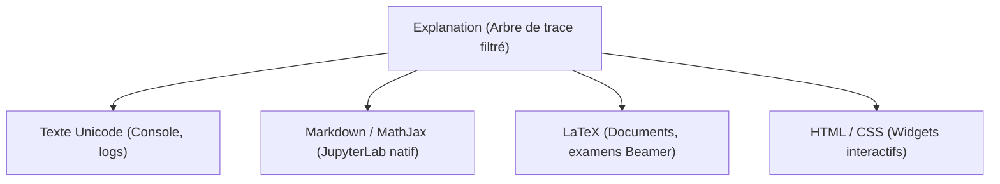

# 06. Rendu, Visualisation et Comparaison Numérique

Le package `linalg_pedagopy` offre des moteurs d'affichage polyvalents, un module graphique géométrique basé sur Matplotlib, ainsi qu'un banc de comparaison formel/numérique pour illustrer les limites du calcul flottant.

---

## 1. Moteurs de rendu multi-formats (`Explanation`)

Toutes les procédures algorithmiques renvoient un résultat muni d'une méthode [`explain(level=...)`](../src/linalg_pedagopy/algorithms/base.py) produisant une instance immuable d'[`Explanation`](../src/linalg_pedagopy/render/explanation.py).



### 1.1 Formats de sortie disponibles

```python
from linalg_pedagopy import Matrix, Vector, GaussJordan

A = Matrix([[1, 2], [3, 4]])
b = Vector([5, 11])
res = GaussJordan(A, b).run()
exp = res.explain(level=2)

# 1. Rendu console Unicode enrichi
print(exp.to_text())

# 2. Rendu LaTeX complet pour documents et polycopiés
print(exp.to_latex())

# 3. Rendu Markdown avec formules mathématiques
print(exp.to_markdown())

# 4. Rendu HTML avec classes CSS
html_code = exp.to_html()

# 5. Enregistrement dans un fichier (format déduit de l'extension)
# exp.save("gauss_jordan.tex")
```

Le paramètre `fmt` de `explain(level=..., fmt="auto")` fixe le format utilisé pour l'affichage automatique ; les méthodes `to_text()`, `to_latex()`, `to_markdown()` et `to_html()` acceptent aussi un argument `level` pour filtrer à nouveau la trace.

Dans un environnement JupyterLab ou Jupyter Notebook, l'objet `Explanation` implémente `_repr_markdown_()` : il s'affiche automatiquement avec un rendu typographique soigné grâce au moteur KaTeX/MathJax sans qu'aucun appel à `print()` ne soit nécessaire.

### 1.2 Localisation et multilinguisme (`locales`)

Tous les messages explicatifs et libellés d'étapes proviennent de dictionnaires YAML situés dans [`src/linalg_pedagopy/render/locales/`](../src/linalg_pedagopy/render/locales/). **Seule la locale française (`fr.yaml`) est fournie actuellement.**

La locale active est lue dans `config.locale` (par défaut `"fr"`) et peut être changée globalement ou localement ; une locale sans fichier YAML (par exemple `"en"`) retombe sur les messages français :

```python
from linalg_pedagopy.config import config, using_config

print(config.locale)          # fr

# Changement temporaire de locale (ici sans effet visible : en.yaml n'existe pas encore)
with using_config(locale="en"):
    print(res.explain())
```

Pour ajouter une langue, il suffit de créer `locales/<code>.yaml` avec les mêmes clés que `fr.yaml`.

---

## 2. Visualisation géométrique 2D et 3D (`linalg_pedagopy.plot`)

Le sous-module [`linalg_pedagopy.plot`](../src/linalg_pedagopy/plot/geometry.py) fournit des représentations géométriques directes des concepts vectoriels via Matplotlib.

> [!NOTE]
> Ce module nécessite l'installation de la dépendance facultative : `pip install linalg_pedagopy[plot]`.

### 2.1 Fonctions graphiques disponibles

| Fonction | Description géométrique | Dimension |
| :--- | :--- | :---: |
| `plot_linear_combination_2d(u, v, c1=1, c2=1, *, ax=None)` | Règle du parallélogramme pour la combinaison linéaire $w = c_1 u + c_2 v$. | $\mathbb{R}^2$ |
| `plot_orthogonal_projection_2d(a, q, *, ax=None)` | Projection orthogonale de $a$ sur la droite $\text{Vect}(q)$ et vecteur résidu. | $\mathbb{R}^2$ |
| `plot_gram_schmidt_2d(vectors, *, ax=None)` | Tracé simultané des vecteurs initiaux et de la base orthonormée $(q_1, q_2)$. | $\mathbb{R}^2$ |
| `plot_least_squares_fit(x_data, y_data, ls_result, *, ax=None)` | Nuage de points, droite/modèle ajusté $\hat{y} = A \hat{x}$ et résidus verticaux. | Plan |
| `plot_least_squares_geometry_3d(ls_result)` | Vue spatiale du vecteur $b$, de sa projection orthogonale $\hat{y}$ sur $\text{Col}(A)$ et du vecteur résidu $\hat{r}$ ($A^T \hat{r} = 0$). | $\mathbb{R}^3$ |

### 2.2 Exemple : Géométrie 3D des Moindres Carrés

```python
from linalg_pedagopy import Matrix, Vector, LeastSquares
from linalg_pedagopy.plot import plot_least_squares_geometry_3d
import matplotlib.pyplot as plt

# Matrice A de taille 3x2 (plan vectoriel dans R^3)
A = Matrix([
    [1, 0],
    [0, 1],
    [1, 1]
])
b = Vector([1, 2, 4])

ls = LeastSquares(A, b).run()

# Génération de la figure 3D
fig = plot_least_squares_geometry_3d(ls)
plt.show()
```

---

## 3. Comparaison Exact vs Virgule Flottante (`linalg_pedagopy.compare`)

Le module [`linalg_pedagopy.compare`](../src/linalg_pedagopy/compare/numeric.py) permet de confronter le calcul symbolique exact aux calculs numériques en virgule flottante standard (IEEE-754 `float64` sous NumPy).

### 3.1 La fonction universelle `compare`

```python
from linalg_pedagopy import Matrix, Vector, GaussJordan, compare

A = Matrix([[1, 2], [3, 4]])
b = Vector([5, 11])
proc = GaussJordan(A, b)

rapport = compare(proc)        # ou compare(GaussJordan, (A, b))
print("Écart absolu maximal :", rapport.max_abs_error)   # 0.0
print("Résumé :", rapport.summary)
```

Le rapport [`ComparisonReport`](../src/linalg_pedagopy/compare/numeric.py) contient `procedure_name`, `exact_result`, `float_result`, `max_abs_error`, `orthogonality_defect_float` (pour `GramSchmidt` et `QR`) et `summary`.

### 3.2 Cas d'école 1 : La matrice de Läuchli et la perte d'orthogonalité

La matrice de Läuchli $L(\epsilon) \in \mathbb{R}^{(n+1) \times n}$ est définie par :
$$L(\epsilon) = \begin{bmatrix} 1 & 1 & \dots & 1 \\ \epsilon & 0 & \dots & 0 \\ 0 & \epsilon & \dots & 0 \\ \vdots & \vdots & \ddots & \vdots \\ 0 & 0 & \dots & \epsilon \end{bmatrix}$$

Pour $\epsilon$ très petit (par exemple $\epsilon = 10^{-8}$), l'algorithme de Gram-Schmidt classique en virgule flottante perd totalement l'orthogonalité des vecteurs générés ($\|Q^T Q - I\| \approx 1$).

```python
from linalg_pedagopy.compare import build_lauchli_matrix, compare
from linalg_pedagopy import GramSchmidt

# Matrice de Läuchli avec epsilon = 10^-8
L = build_lauchli_matrix(n=3, epsilon="1/100000000")
proc = GramSchmidt(L)          # une Matrix est acceptée (ses colonnes)

rapport = compare(proc)
print("Défaut d'orthogonalité en float64 :", rapport.orthogonality_defect_float)  # ≈ 0.5
# En virgule flottante, les vecteurs q2 et q3 ne sont plus du tout orthogonaux !
# En calcul formel linalg_pedagopy, l'orthogonalité est rigoureusement exacte.
```

Des expériences prêtes à l'emploi comparent aussi Gram-Schmidt classique, modifié et exact, ainsi que les équations normales et QR :

```python
from linalg_pedagopy.compare import (
    lauchli_gram_schmidt_experiment,
    lauchli_least_squares_experiment,
    hilbert_conditioning_experiment,
    explicit_inverse_vs_solve_experiment,
)

print(lauchli_gram_schmidt_experiment())
# Matrice de Läuchli (4x3, ε = 1.0e-08) :
# - Exact (SymPy)              : max |q_i^T q_j - δ_ij| = 0
# - Gram-Schmidt classique     : max |q_i^T q_j - δ_ij| = 0.5000 (perte totale d'orthogonalité)
# - Gram-Schmidt modifié (MGS) : max |q_i^T q_j - δ_ij| = 7.07e-09
```

### 3.3 Cas d'école 2 : La matrice de Hilbert et le mauvais conditionnement

La matrice de Hilbert d'ordre $n$, $H_{ij} = \frac{1}{i + j + 1}$ (indices à partir de 0), est célèbre pour son conditionnement qui croît exponentiellement ($\text{cond}(H_n) \approx e^{3.5 n}$).

L'erreur relative d'un solveur flottant croît avec ce conditionnement, alors qu'avec `linalg_pedagopy` les coefficients restent des fractions exactes, quelle que soit la dimension :

```python
print(hilbert_conditioning_experiment())
# Matrices de Hilbert H_n :
# - n =  3 : cond(H_n) ≈ 5.24e+02, erreur relative flottante ≈ 8.36e-15 (exact : 0)
# - n =  5 : cond(H_n) ≈ 4.77e+05, erreur relative flottante ≈ 1.68e-12 (exact : 0)
# - n =  7 : cond(H_n) ≈ 4.75e+08, erreur relative flottante ≈ 1.01e-09 (exact : 0)
# - n =  9 : cond(H_n) ≈ 4.93e+11, erreur relative flottante ≈ 1.18e-06 (exact : 0)
```

(les erreurs flottantes exactes peuvent varier légèrement selon la plateforme).

```python
from linalg_pedagopy.compare import build_hilbert_matrix
from linalg_pedagopy import Vector, GaussJordan

# Matrice de Hilbert d'ordre 8
H = build_hilbert_matrix(8)
b = Vector([1] * 8)

res = GaussJordan(H, b).run()
print("Solution exacte rationnelle :")
print(res.solution.x)   # (-8, 504, -7560, 46200, -138600, 216216, -168168, 51480)
```
