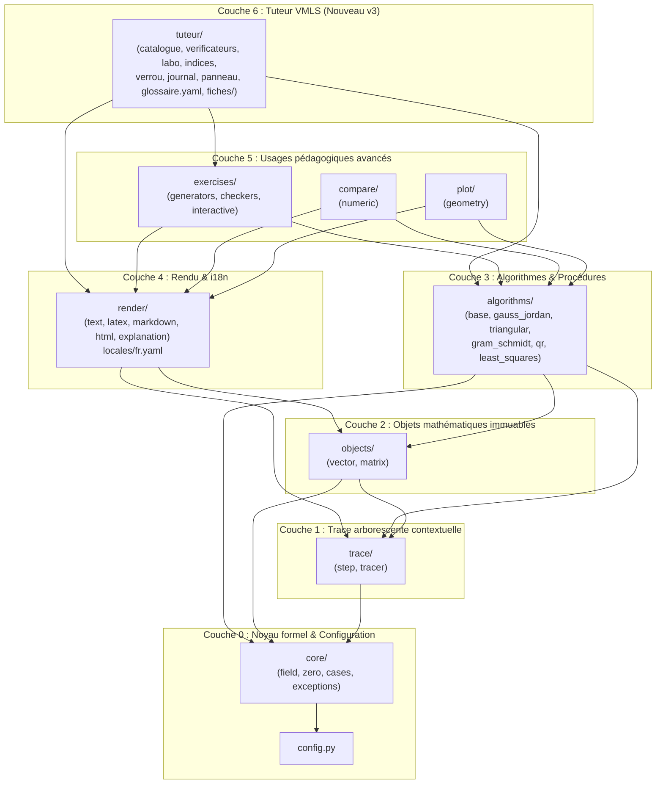

# Plan d'implémentation — `linalg_pedagopy` v3.0

## Objectif et contexte

Ce plan décrit la refonte complète du package `linalg_pedagopy` directement vers la **version 3.0 (`3.0.0`)**, conformément aux spécifications de `linalg_pedagopy_plan_v3.pdf` (document de travail non publié).

La version 3 réunit :
1. **Toutes les avancées architecturales de la v2 (Décisions D1 à D11)** :
   - Travail sur $\mathbb{R}$ (`real=True`, **D1**), politique de coercition explicite des flottants (`float_policy`, **D2**), oracle de nullité à 4 verdicts (`ZERO`, `NONZERO`, `CONDITIONAL`, `UNKNOWN`, **D3**) et discussion automatique selon les paramètres (`CaseSplit`, **D4**).
   - Objets mathématiques `Vector` et `Matrix` **immuables** (**D5**), trace arborescente contextuelle via `contextvars` à 4 niveaux (`0` à `3`, **D6**), et moteurs de rendu découplés (`text`, `latex`, `markdown`, `html`) avec architecture internationalisée (`locales/fr.yaml`, **D7**).
   - Résultats typés (`GJResult`, `SolutionSet`, `GSResult`, `QRResult`, `LSResult`) au lieu d'exceptions (**D8**), conventions VMLS (**D9**), calcul interne sur `DomainMatrix` (**D10**), choix du pivot le plus simple en exact (**D11**).
   - Algorithmes complets (`GaussJordan`, `BackSubstitution`, `ForwardSubstitution`, `GramSchmidt` rationnel et pas-à-pas, `QR` rationnelle et normalisée, `LeastSquares`), générateurs d'exercices à résultats « propres », modes interactifs et module `compare` (exact vs flottant).
2. **Les nouveautés de la v3 (§1.1, §7 et §11)** :
   - **Module `tuteur/`** : accompagne les étudiants de L1–L2 dans les exercices du recueil officiel *Additional Exercises for Vectors, Matrices, and Least Squares* (Boyd & Vandenberghe, éd. 24 novembre 2020) dans JupyterLab **sans jamais donner la solution en mode étudiant**.
   - **8 principes pédagogiques du tuteur (§7.3)** : vérification par propriété plutôt que par corrigé, diagnostic de ce que calcule la réponse de l'étudiant, échelle d'indices gradués sur 4 niveaux, exercice jumeau résolu au niveau 4, verrou sur les données d'exercice (`verrou.py`), prédiction obligatoire avant d'ouvrir le laboratoire de contre-exemples (`labo.py`), refus de confirmer un « vrai » par de simples essais, et journal local JSON transparent pour l'enseignant (`journal.py`).

---

## Décisions validées (§11 du Plan v3)

> [!IMPORTANT]
> **Décisions entérinées pour la v3 :**
> - **Nom du package** : `linalg_pedagopy` (dépôt `linalg-pedagopy`, layout `src/linalg_pedagopy/`).
> - **Licence** : MIT.
> - **Public prioritaire** : Étudiants de L1–L2.
> - **Interface interactive** : JupyterLab ($\ge 4$) avec panneaux `ipywidgets` (tout en conservant une API Python utilisable dans les notebooks et scripts).
> - **Langue** : Français uniquement (`locales/fr.yaml` + `tuteur/glossaire.yaml` anglais–français) ; l'architecture d'internationalisation reste prête sans catalogue anglais planifié.
> - **Paramètres fixés en Phase 0** :
>   - Version minimale de SymPy : **`sympy >= 1.12`** (testé sur SymPy `1.14.0` présent dans l'environnement).
>   - Politique de déblocage des indices par défaut : déblocage séquentiel (niveaux $1 \to 2 \to 3 \to 4$) après une tentative ou une demande explicite sans délai bloquant par défaut (`min_attempts_between_hints: int = 0`, `min_delay_seconds: int = 0`, configurables par l'enseignant).
> - **Périmètre d'exécution immédiat** : Réalisation complète des **Phases 0 à 6 incluse** (socle complet `core`, `trace`, `objects`, `algorithms`, `render`, `exercises`, `compare`, `plot` + moteur complet de `tuteur/` + les **33 fiches d'exercices « complets » `●`** de l'Annexe D ainsi que les fiches d'exemples `3.3` et `3.13` de la §7.7–7.8).

---

## Architecture cible et flux de dépendances



---

## Changements proposés par composant

### Phase 0 — Squelette du projet, configuration et outillage

#### [MODIFY] `pyproject.toml`
- Passage en version `3.0.0`, `requires-python = ">=3.11"`, licence `MIT`.
- Layout `src/linalg_pedagopy` avec package-data incluant `render/locales/*.yaml`, `tuteur/glossaire.yaml` et `tuteur/fiches/*.yaml`.
- Dépendances obligatoires : `sympy>=1.12`, `pyyaml>=6.0`.
- Extras :
  - `tuteur = ["ipywidgets>=8.0", "jupyterlab>=4.0"]`
  - `plot = ["matplotlib>=3.7"]`
  - `compare = ["numpy>=1.24"]`
  - `dev = ["pytest>=7.0", "hypothesis>=6.80", "syrupy>=4.0", "mypy>=1.5", "ruff>=0.1", "coverage>=7.0"]`

#### [DELETE] Ancienne arborescence `linalg_pedagopy/` (racine)
- Suppression des anciens modules v1 (`linalg_pedagopy/core/base.py`, `vectors.py`, `matrices.py`, `least_squares.py`) au profit de `src/linalg_pedagopy/`.

#### [NEW] `src/linalg_pedagopy/config.py`
- Gestion centralisée et contextuelle (`contextvars`) de la configuration :
  - `float_policy: Literal["rationalize", "reject", "keep"] = "rationalize"`
  - `locale: str = "fr"`
  - `default_trace_level: int = 1`
  - `max_case_depth: int = 3`, `max_cases: int = 8`
  - `tutor_mode: Literal["etudiant", "enseignant"] = "etudiant"`
  - `hint_min_attempts: int = 0`, `hint_min_delay_seconds: int = 0`
  - `journal_path: Path` (par défaut `.linalg_pedagopy_journal.json`)

---

### Phase 1 — Noyau (`core/`), Trace (`trace/`), Objets (`objects/`) et Rendu (`render/`)

#### [NEW] `src/linalg_pedagopy/core/exceptions.py`
Hiérarchie conforme au §5.1.4 (avec l'exception de verrou du tuteur) :
- `PedagopyError(Exception)`
- `DimensionMismatchError(PedagopyError, ValueError)`
- `InexactInputError(PedagopyError, ValueError)`
- `UndecidableZeroError(PedagopyError, ArithmeticError)`
- `SingularMatrixError(PedagopyError, ArithmeticError)`
- `LinearDependenceError(PedagopyError, ArithmeticError)`
- `RankDeficientError(PedagopyError, ArithmeticError)`
- `UndefinedOperationError(PedagopyError, ArithmeticError)`
- `LockedExerciseDataError(PedagopyError, PermissionError)` (levée lorsqu'un étudiant tente d'appeler une méthode de calcul sur une donnée verrouillée avant d'avoir soumis une réponse).

#### [NEW] `src/linalg_pedagopy/core/field.py`
- `symbols(names) -> tuple[sp.Symbol, ...]` : symboles portant `real=True` (**D1**).
- `to_exact(x) -> sp.Expr` : applique `float_policy` (**D2** : `"rationalize"` via `sp.Rational(repr(x))` avec avertissement tracé, `"reject"`, `"keep"`), recrée en `real=True` tout symbole externe non typé réel avec avertissement dans la trace.
- `choose_domain(entries)` : sélectionne $\mathbb{Q}$ (`QQ`), $\mathbb{Q}(\text{params})$, corps algébrique ou `EX` pour `DomainMatrix` (**D10**).

#### [NEW] `src/linalg_pedagopy/core/zero.py` & `src/linalg_pedagopy/core/cases.py`
- `Verdict(Enum)` (`ZERO`, `NONZERO`, `CONDITIONAL`, `UNKNOWN`) et `ZeroDecision(verdict, condition, method)`.
- `ZeroOracle.decide(e, assumptions=...)` (**D3**) :
  1. Domaine exact ($\mathbb{Q}$ ou $\mathbb{Q}(a, b, \dots)$) $\to$ `ZERO`, `NONZERO` ou `CONDITIONAL` (avec annulation du numérateur).
  2. Nombres algébriques (radicaux) $\to$ `minimal_polynomial(e) == x`.
  3. Simplification (`radsimp`, `simplify`, `equals(0)`).
  4. Contrôle numérique haute précision (`evalf(50)`) confirmant uniquement `NONZERO`.
  5. Sinon `UNKNOWN` $\to$ lève `UndecidableZeroError` sauf hypothèse fournie.
- `Condition` (conjonction d'égalités et d'inégalités polynomiales) et `CaseSplit[R]` (branches `(condition, result, trace)` avec `.generic()`, `.at(**values)`, `.explain()`).

#### [NEW] `src/linalg_pedagopy/trace/step.py` & `src/linalg_pedagopy/trace/tracer.py`
- `StepKind(Enum)` et `Step` (nœud d'arbre immuable : `kind`, `level`, `message_key`, `params`, `snapshot`, `highlight`, `children`).
- Contexte `with tracing(level=2) as t:`, `with section(message_key, **params):`, `record(...)` sans aucun surcoût hors contexte.

#### [NEW] `src/linalg_pedagopy/objects/vector.py` & `src/linalg_pedagopy/objects/matrix.py`
- `Vector` immuable (**D5**) : `Vector([1, "1/2", sqrt(2)])`, `zeros`, `ones`, `unit(i, n)`, opérations `+`, `-`, `*`, `dot`, `norm`, `rms`, `avg`, `std`, `demean`, `distance`, `angle` (avec contrôle de Cauchy-Schwarz), `combination`, `is_zero`.
- `Matrix` immuable (**D5**) : `from_columns`, `from_rows`, `identity`, `zeros`, `block`, produit `@` (et `.matmul(B, view="entries"|"rows"|"columns"|"outer")`), `.T`, `.gram()`, `.rank()`, `.nullspace()`, `.rref()`, `.inv()`, `.solve(b)`, `.has_orthonormal_columns()`.

#### [NEW] `src/linalg_pedagopy/render/`
- `locales/fr.yaml` : catalogue complet des messages pédagogiques paramétrés en français.
- `text.py` (Unicode `sympy.pretty` + arbre `├─`/`└─`), `latex.py` (matrices augmentées `\left[\begin{array}{...|...}\right]`, pivots encadrés, flèches d'opérations), `markdown.py`, `html.py` et `explanation.py` (`Explanation`).

---

### Phase 2 — Gauss-Jordan, substitutions triangulaires et discussion par cas

#### [NEW] `src/linalg_pedagopy/algorithms/base.py`, `gauss_jordan.py`, `triangular.py`
- `Procedure[R]` (`.run()`, `.interactive()`) et `Result` (`.explain()`, `.verify()`).
- `GaussJordan(A, b=None, *, pivot_strategy="simplest", strict=False, max_depth=3, max_cases=8)` :
  - Pivot non nul le plus simple (**D11**).
  - Si un pivot ou un test de compatibilité est `CONDITIONAL`, construit un `CaseSplit[GJResult]` (**D4**).
  - Résultat `GJResult` contenant `rref`, `pivots`, `rank`, `free_vars`, `inverse` et `solution` typée parmi `UniqueSolution(x)`, `AffineSolution(x0, basis)`, `EmptySolution(row, witness)` (**D8**).
- `BackSubstitution(R, c)` et `ForwardSubstitution(L, c)` : résolution triangulaire ligne par ligne tracée sans inversion.

---

### Phase 3 — Gram-Schmidt (deux variantes) et Factorisation QR

#### [NEW] `src/linalg_pedagopy/algorithms/gram_schmidt.py` & `qr.py`
- `GramSchmidt(vectors, *, normalize="end" | "each", strict=False)` :
  - `normalize="end"` (défaut) : orthogonalisation rationnelle $\tilde{q}_i = a_i - \sum_{j<i} \frac{\tilde{q}_j^T a_i}{\tilde{q}_j^T \tilde{q}_j} \tilde{q}_j$, normalisation à la fin.
  - `normalize="each"` : variante de VMLS avec normalisation immédiate.
  - Résultat `GSResult(independent=..., witness=...)` avec témoin exact de dépendance linéaire $a_i = \sum_{j<i} \tilde{r}_{ji}\tilde{q}_j$.
- `QR(A, *, strict=False)` : factorisation rationnelle $A = \tilde{Q}\tilde{R}$ ($\tilde{Q}^T \tilde{Q} = D^2$) puis $A = QR$ à diagonale de $R$ strictement positive ; `.verify()` contrôle $QR = A$ et $Q^T Q = I_n$ via `ZeroOracle`.

---

### Phase 4 — Moindres carrés (`least_squares.py`)

#### [NEW] `src/linalg_pedagopy/algorithms/least_squares.py`
- `LeastSquares(A, b, *, method="rational_qr" | "qr" | "normal")` :
  - Vérification du rang plein en colonnes (ou `RankDeficientError` / `CaseSplit`).
  - Méthode par défaut `"rational_qr"` : résout $\tilde{R}\hat{x} = D^{-2}\tilde{Q}^T b$ par `BackSubstitution` entièrement dans $\mathbb{Q}$.
  - Méthodes `"qr"` ($R\hat{x} = Q^T b$) et `"normal"` ($A^T A \hat{x} = A^T b$ via `GaussJordan`).
  - Formule théorique de la pseudo-inverse $A^\dagger = (A^T A)^{-1} A^T$.
  - Analyse complète : $\hat{y} = A\hat{x}$, résidu $\hat{r} = A\hat{x} - b$, $\|\hat{r}\|$, $\text{rms}(\hat{r}) = \|\hat{r}\|/\sqrt{m}$, et `.verify()` traçant $A^T \hat{r} = 0$ colonne par colonne.

---

### Phase 5 — Exercices interactifs (`exercises/`), Comparaison (`compare/`) et Figures (`plot/`)

#### [NEW] `src/linalg_pedagopy/exercises/`
- `generators.py` : 5 générateurs reproductibles (`seed`, `difficulty`) :
  1. Matrices unimodulaires entières ($\det = \pm 1$) pour l'inversion entière ;
  2. Forme échelonnée réduite entière $\text{rref}(PR) = R$ ;
  3. Matrices orthogonales rationnelles par **transformée de Cayley** $Q = (I - S)(I + S)^{-1}$ pour Gram-Schmidt / QR sans radicaux ;
  4. Moindres carrés à solution entière $\hat{x}$ et résidu $r \in \ker(A^T)$ choisis ;
  5. Systèmes paramétrés à valeur critique rationnelle simple (plus générateurs dédiés aux exercices jumeaux du tuteur, ex. `moyenne_glissante`).
- `checkers.py` & `interactive.py` : validation d'opérations proposées (`s.propose("L2 <- L2 - 3*L1")`, `s.hint()`) avec détection des 7 erreurs fréquentes de l'Annexe C ; modes `"read"`, `"predict_reveal"`, `"completion"`, `"autonomous"`.

#### [NEW] `src/linalg_pedagopy/compare/numeric.py` & `plot/geometry.py`
- `compare(procedure, inputs)` et les 4 expériences numériques de VMLS (§5.7) :
  1. Gram-Schmidt classique vs modifié vs exact sur la matrice de Läuchli ($\varepsilon = 10^{-8}$) ;
  2. Équations normales vs QR sur la matrice de Läuchli ($1 + \varepsilon^2 = 1$ en flottant) ;
  3. Matrices de Hilbert (conditionnement et erreur relative) ;
  4. Inversion explicite $A^{-1}b$ vs résolution directe.
- `plot/geometry.py` : visualisations 2D/3D Matplotlib (combinaisons linéaires, projections, étapes de Gram-Schmidt, ajustement par moindres carrés et géométrie 3D de $b, \hat{y}, \hat{r}$).

---

### Phase 6 — Tuteur pour le recueil d'exercices de VMLS (`tuteur/`)

Conformément à la Section 7 du Plan v3, ce module accompagne l'étudiant sans jamais révéler la solution en mode étudiant :

#### [NEW] `src/linalg_pedagopy/tuteur/verrou.py`
- Encapsule les données numériques d'un exercice (`LockedVector`, `LockedMatrix`, `LockedNamespace` exposé sous `ex.donnees`).
- Toute tentative d'appeler `.rms()`, `.norm()`, `.dot()`, `@`, `.solve()`, etc. sur `ex.donnees` tant qu'aucune réponse n'a été proposée lève `LockedExerciseDataError` avec un message pédagogique invitant l'étudiant à effectuer ou proposer d'abord son calcul.
- Une fois une réponse juste validée par `ex.verifier(...)`, le verrou s'ouvre automatiquement et permet d'afficher la trace complète comme corrigé de son propre travail.

#### [NEW] `src/linalg_pedagopy/tuteur/indices.py`
- Gère l'échelle d'indices à **4 niveaux** (§7.5) :
  - **Niveau 1 — Orientation** : reformulation, données, inconnue, tailles, chapitre VMLS.
  - **Niveau 2 — Outil** : rappel de la définition ou propriété mathématique utile.
  - **Niveau 3 — Démarrage** : question guidée sur la première étape concrète.
  - **Niveau 4 — Jumeau** : résolution complète et tracée d'un exercice analogue généré avec d'autres données (ou indication d'existence d'un contre-exemple pour un vrai/faux).
- Applique la politique de déblocage progressif (un niveau par appel à `ex.indice()`, respectant les paramètres `hint_min_attempts` et `hint_min_delay_seconds`). Aucun niveau 5 « solution » n'existe en mode étudiant.

#### [NEW] `src/linalg_pedagopy/tuteur/verificateurs.py`
Implémente les **9 vérificateurs spécialisés** (§7.6) qui décrivent l'erreur de l'étudiant sans jamais afficher la réponse attendue :
1. `produit_scalaire` : pour un vecteur $a$ proposé, forme symboliquement $a^T c$ et compare à la cible ; diagnostique mauvaise dimension, composante parasite, facteur d'échelle manquant (« vérifiez la normalisation ») ou erreur de signe.
2. `matrice` : vérifie les dimensions $(m, n)$, puis évalue symboliquement $Ax$ ligne par ligne face à la cible (« Taille correcte ($3 \times 6$). Lignes 1 et 3 correctes. Votre ligne 2 calcule $d_2 = \dots$ ; relisez la définition de $d_2$ »).
3. `formule` : vérifie une expression symbolique en fonction des paramètres (ex. $\|u\|^2, \|v\|^2, u^T v$), à la fois formellement via `ZeroOracle` et sur des familles rationnelles générées par transformée de Cayley.
4. `valeur` : calcule à la volée la cible à partir des données de la fiche et teste l'égalité via `ZeroOracle` ; exécute les **détecteurs d'erreurs typiques** (§7.6 : $\|x\|$ au lieu de $\text{rms}(x)$, écart-type en $1/(n-1)$ au lieu de $1/n$, distance au carré $\|x-y\|^2$, cosinus de l'angle sur vecteurs non centrés au lieu de la corrélation).
5. `propriete` : valide toute réponse satisfaisant la propriété définissante ($AB = I$, équations de la VAN, équations normales $A^T(Ax-b)=0$, conditions d'optimalité KKT), acceptant ainsi les exercices à infinité de solutions (ex. 11.7, 11.11).
6. `contre_exemple` : vérifie que l'instance fournie par l'étudiant satisfait les hypothèses de l'énoncé et met en défaut la conclusion ; attribue une **note de simplicité** (dimension, hauteur des coefficients entiers).
7. `labo` : délègue au laboratoire de contre-exemples (`labo.py`).
8. `egalites` : vérifie maillon par maillon une chaîne d'égalités algébriques sous les hypothèses déclarées.
9. `dimensions` : évalue symboliquement la validité et la dimension $(m \times n)$ d'expressions matricielles/vectorielles ou signale l'opération incompatible.

#### [NEW] `src/linalg_pedagopy/tuteur/labo.py`
- `CounterexampleLab` :
  - Exige que l'étudiant ait d'abord enregistré sa prédiction via `ex.predire(...)` (**Principe 6 : s'engager avant d'explorer**).
  - `lab.tester(**instances)` : vérifie d'abord que les vecteurs/matrices passés respectent les hypothèses de l'exercice (ex. $a \perp c$ et $b \perp c$), puis évalue chaque affirmation sur cette instance.
  - **Principe 7** :
    - Si l'énoncé est vrai sur l'instance : rappelle explicitement que *« des essais ne suffisent pas à prouver qu'un énoncé est toujours vrai : rédigez une justification »*.
    - Recherche interne sur des familles structurées (vecteurs nuls, colinéaires, orthogonaux, matrices non commutantes) : si l'étudiant a prédit « toujours vrai » alors qu'un contre-exemple existe en interne, le tuteur signale qu'il en existe un (et sa dimension/famille au niveau 4 d'indice), **sans jamais l'afficher**.

#### [NEW] `src/linalg_pedagopy/tuteur/journal.py` & `panneau.py`
- `journal.py` : enregistre localement en JSON (par exercice) l'horodatage, les prédictions, le nombre de tentatives, les diagnostics reçus, les indices débloqués, l'ouverture du jumeau et le temps passé ; fournit `ex.bilan()`.
- `panneau.py` : construit le panneau interactif `ipywidgets` pour JupyterLab (`ex.panneau()`) avec onglets/boutons *Énoncé*, *Indice (1–4)*, *Vérifier*, *Laboratoire*, *Exercice jumeau* et *Bilan*.

#### [NEW] `src/linalg_pedagopy/tuteur/catalogue.py`, `glossaire.yaml` et `fiches/`
- `glossaire.yaml` & `glossaire(terme: str)` : traduction et explication anglais–français des termes de VMLS (*least squares*, *root-mean-square (rms)*, *de-meaned vector*, *standard deviation*, *Gram matrix*, *left/right inverse*, *back substitution*, *running average*, *net present value (NPV)*, *cash flow*, *Vandermonde*, *Tchebychev inequality*, etc.).
- `catalogue.py` :
  - `exercice(id: str) -> ExerciceSession` (avec `.enonce()`, `.indice()`, `.verifier(...)`, `.predire(...)`, `.labo()`, `.jumeau()`, `.bilan()`, `.panneau()`, `.donnees`).
  - `mode("etudiant" | "enseignant")` : active le mode enseignant pour inspecter les fiches et tester les vérificateurs.
  - `valider_fiche(id: str) -> ValidationReport` : vérifie automatiquement qu'une fiche YAML est bien formée, que sa cible est valide, que son générateur jumeau produit une instance résoluble de même structure, et qu'**aucun indice ne divulgue la réponse**.
- `fiches/*.yaml` : rédaction et validation des **33 fiches d'exercices « complets » (`●`)** de l'Annexe D couvrant les chapitres 1–3, 5–8, 10–12 et 20 :
  - **Chap. 1** : `1.2`, `1.3`, `1.4`
  - **Chap. 2** : `2.1`, `2.2`
  - **Chap. 3** : `3.2`, `3.5`, `3.9`, `3.11`, `3.14` (+ `3.3` et `3.13` pour illustrer le `labo` de la §7.7–7.8)
  - **Chap. 5** : `5.2`
  - **Chap. 6** : `6.4`, `6.10`
  - **Chap. 7** : `7.2`, `7.5`
  - **Chap. 8** : `8.1`, `8.3`
  - **Chap. 10** : `10.5`, `10.6`, `10.10`, `10.14`, `10.16`
  - **Chap. 11** : `11.7`, `11.9`, `11.10`, `11.11`, `11.12`
  - **Chap. 12** : `12.6`
  - **Chap. 20** : `20.2`, `20.6`, `20.7`, `20.8`, `20.11`

---

### Phases 7 et 8 (Feuille de route ultérieure planifiée)
- **Phase 7** : Extension des fiches YAML aux 62 exercices « partiels » (`◐`) de l'Annexe D (vrai/faux, justifications pas à pas, modélisation des chapitres 12–16).
- **Phase 8** : Extensions algorithmiques (`LinearDynamicalSystem` ch. 9, `PolynomialFit` ch. 13, `RegularizedLeastSquares` ch. 15 avec $\lambda$ symbolique, `ConstrainedLeastSquares` ch. 16 par système KKT), notebooks de cours et documentation MkDocs.

---

## Plan de vérification et de tests

### Suite de tests automatisés (`tests/`)
Conformément à la section 8.1 du Plan v3 :
- `tests/test_field.py` : coercition des entrées (`"rationalize"`, `"reject"`, `"keep"`), symboles `real=True`, domaines `DomainMatrix`.
- `tests/test_zero.py` : les 4 verdicts de `ZeroOracle`, radicaux ($\sqrt{2}\sqrt{3} - \sqrt{6} = 0$), paramètres, `UndecidableZeroError`.
- `tests/test_cases.py` : discussion par cas `CaseSplit`, `.generic()`, `.at()`, garde-fous `max_depth` et `max_cases`.
- `tests/test_tracer.py` : hiérarchie d'étapes, filtrage par niveau `0..3`, absence de trace hors contexte.
- `tests/test_vector.py` & `tests/test_matrix.py` : immutabilité, opérations, 4 vues du produit matriciel, matrice de Gram.
- `tests/test_gauss_jordan.py` : rang, `UniqueSolution`, `AffineSolution`, `EmptySolution`, inversion, discussion selon un paramètre (dont l'exemple de l'Annexe A).
- `tests/test_triangular.py` : `BackSubstitution` et `ForwardSubstitution`.
- `tests/test_gram_schmidt.py` : variantes `normalize="end"` et `normalize="each"`, témoin de dépendance linéaire, égalité des résultats.
- `tests/test_qr.py` : $QR = A$, $Q^T Q = I_n$, diagonale de $R$ positive.
- `tests/test_least_squares.py` : cohérence des 3 méthodes (`"rational_qr"`, `"qr"`, `"normal"`), $A^T \hat{r} = 0$, rang déficient.
- `tests/test_render.py` : sorties texte, LaTeX, Markdown et HTML.
- `tests/test_exercises.py` : propriétés garanties des 5 générateurs (unimodulaire, rref, Cayley QR, moindres carrés, paramètre) et vérificateur d'opérations (Annexe C).
- `tests/test_compare.py` : reproduction des écarts numériques (matrice de Läuchli $\varepsilon = 10^{-8}$, Hilbert).
- `tests/test_tuteur.py` :
  - Validation automatique de toutes les fiches YAML via `valider_fiche` (cible bien formée, jumeau résoluble de même structure, absence de fuite de la réponse dans les indices) ;
  - Test des 9 vérificateurs sur des réponses exactes et sur des réponses fausses typiques (ex. ligne 2 erronée sur l'exercice `6.4`, $\|x\|$ au lieu de $\text{rms}(x)$ sur `3.9`, inverse à droite multiple sur `11.11`, contre-exemple sur `3.3`, verrouillage/déverrouillage de `ex.donnees`, journal JSON).

### Commandes de vérification

```powershell
# Exécution complète de la suite de tests v3
python -m pytest tests/ -v

# Exécution du script de démonstration v3 (exemples de l'Annexe A + séance Tuteur §7.8)
python demo.py
```
